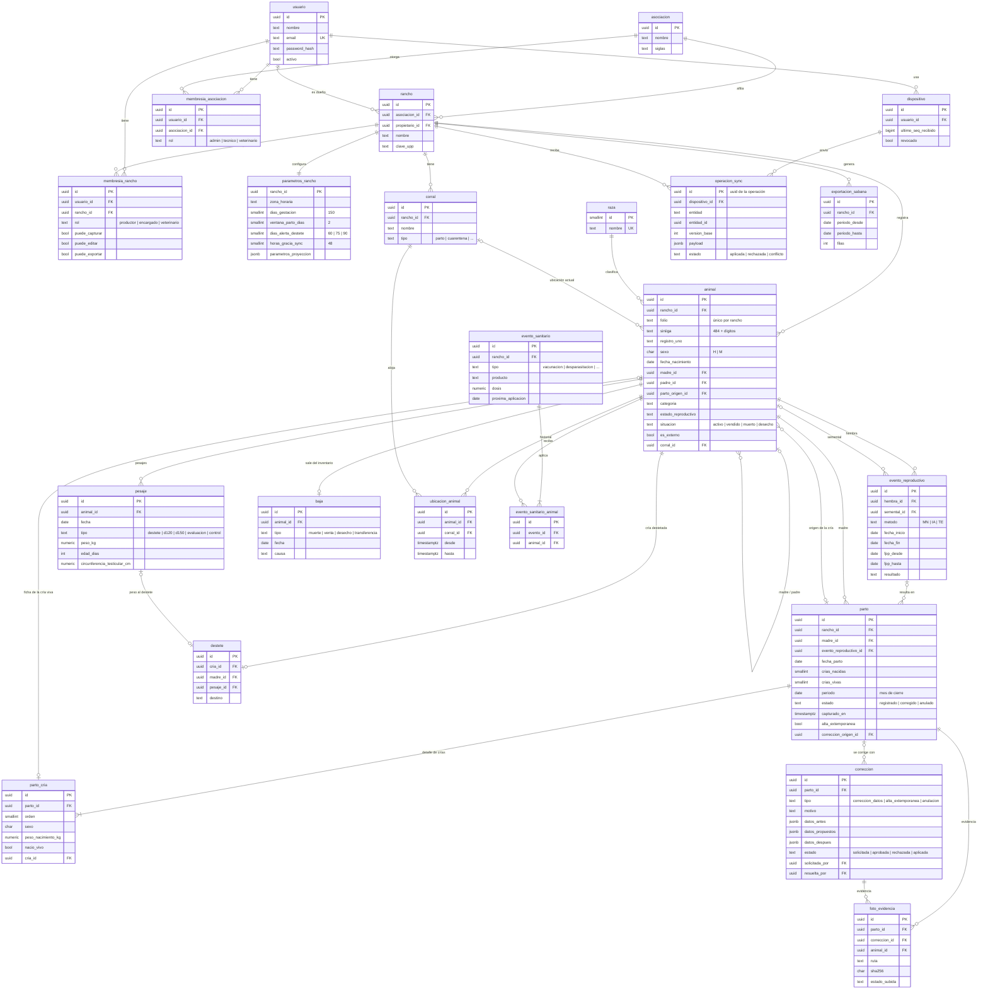
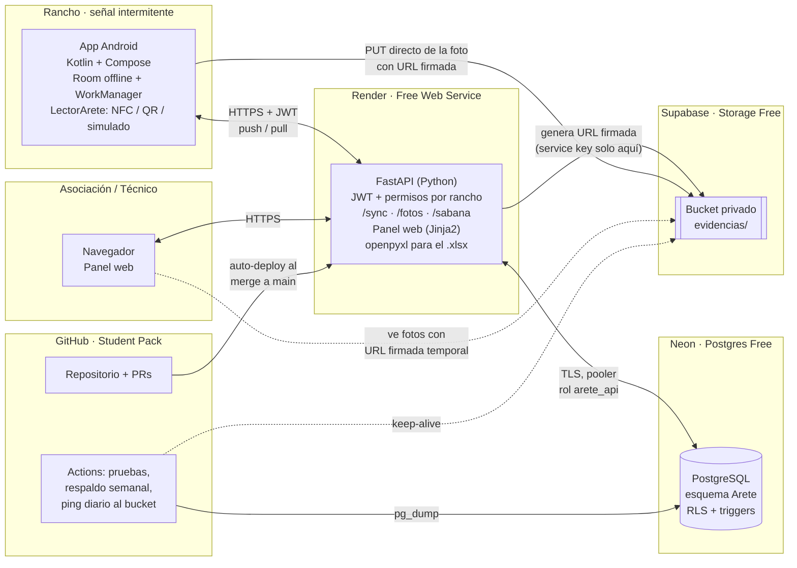

# Modelo de datos y arquitectura en la nube — Arete

**Proyecto:** Gestión ovina para ranchos pequeños y medianos · **Fecha:** 12 nov 2026 · **Versión:** 1.1 (nombre del producto: Arete, antes "OviApp"; rol de BD renombrado a `arete_api`)
**Responsable:** Luis Felipe Ramírez Torres (backend, BD y nube) · **Estado:** [PROPUESTO], script probado en PostgreSQL 16
**Relacionado:** `docs/01_acta_y_alcance.md`, `contexto_proyecto_oviapp.md`

---

## 1. Decisiones de diseño

| Decisión | Cómo se implementa | Por qué |
|---|---|---|
| **UUID como PK** | `id uuid`, generado por la app Android al capturar (el servidor usa `gen_random_uuid()` si no viene). | Permite crear registros offline sin choques de IDs y reintentar sin duplicar (RF-14). |
| **Aislamiento por rancho** | Toda tabla operativa lleva `rancho_id`. FastAPI valida permisos en cada petición; además, **RLS** en PostgreSQL como segunda barrera. | RNF-02: un usuario nunca ve datos de otro rancho, aunque el API tenga un bug. |
| **ID interno inmutable** | `animal.id` (uuid) es la llave real. Folio, SINIIGA y Registro UNO son atributos con índices únicos parciales. | El folio se repite entre ranchos y puede cambiar (contexto §6.3). |
| **Borrado lógico** | `eliminado_en/por/motivo` en todas las tablas sincronizables. El rol del API **no tiene `DELETE`** y un trigger lo bloquea (`OV008`). | RF-17: muertos y vendidos nunca se borran; además, el borrado lógico es lo que permite propagar "eliminaciones" a los celulares. |
| **Muerte/venta ≠ borrado** | `baja` (muerte, venta, desecho, transferencia) cambia `animal.situacion`; el animal sigue en la BD para estadísticas y evaluación materna. | Mortalidad, conciliación SINIIGA y descarte de madres dependen del historial. |
| **Columnas de sincronización estándar** | `version`, `seq_sync`, `creado_en/por`, `actualizado_en/por`, `eliminado_*`, agregadas por el procedimiento `habilitar_sync()`. En SQLAlchemy será un *mixin*. | Control optimista (`version`), descarga incremental (`seq_sync`) y auditoría básica. |
| **Estados como dimensiones** | `sexo`, `categoria`, `estado_reproductivo`, `destino`, `estado_sanitario`, `situacion` son columnas separadas con `CHECK`. | Contexto §6.4: no es un solo enum. `text + CHECK` es más fácil de ampliar que `ENUM`. |
| **Anti-fraude en la BD** | Triggers: ventana de cierre de mes, candado del parto, foto obligatoria, conteo de crías e intervalo mínimo entre partos. | RF-06/07: la regla no depende de que la app o el API "se porten bien". |
| **Auditoría de correcciones** | `correccion` guarda *antes / propuesto / después*, quién solicitó, quién aprobó y cuándo; `bitacora_auditoria` registra cada cambio, es de solo inserción y liga el cambio con la corrección. | RF-19: el original nunca se pierde. |
| **Hora de Jalisco** | La BD queda en `America/Mexico_City` y cada rancho tiene `zona_horaria`. | Neon arranca en UTC: a las 7 pm de Zapopan, `current_date` ya sería "mañana" (lo detectamos en las pruebas). |
| **Fotos fuera de la BD** | La BD solo guarda metadatos (`ruta`, `sha256`, tamaño, fecha). Los bytes van a un bucket privado. | La BD gratuita es pequeña; el hash prueba que la foto no se cambió. |

## 2. Diagrama entidad-relación

Las tablas de fase 2 (`etapa_nutricional`, `ingrediente`, `precio_ingrediente`, `formula`, `formula_ingrediente`, `movimiento_economico`) están en el script, pero se omiten del diagrama para que sea legible. Las columnas estándar de sincronización (`version`, `seq_sync`, `creado_*`, `actualizado_*`, `eliminado_*`) existen en todas las tablas marcadas con ⟳ en el diccionario y tampoco se repiten aquí.



## 3. Diccionario de tablas

⟳ = tiene columnas de sincronización estándar y se replica en el celular · 🔒 = tiene RLS por rancho.

| Tabla | Propósito | Claves e índices relevantes | RF |
|---|---|---|---|
| `asociacion` | AGLOT y futuras asociaciones | `lower(nombre)` único | RF-02 |
| `usuario` | Cuentas; contraseña con hash | `lower(email)` único entre no eliminados | RF-01 |
| `rancho` ⟳ | Rancho, dueño (cuenta matriz) y asociación | índices por asociación y propietario | RF-02 |
| `membresia_asociacion` | Técnico/admin de la asociación → ve **todos** los ranchos afiliados | `(usuario, asociacion)` único | RF-03 |
| `membresia_rancho` ⟳ | Dueño, encargado (rama) o veterinario de 1..n ranchos, con permisos | `(usuario, rancho)` único | RF-04 |
| `dispositivo` | Cada instalación de la app; se puede revocar | — | RF-14 |
| `parametros_rancho` ⟳ 🔒 | DGest, ventana ±2, alerta de destete, gracia de sync, parámetros del Excel en `jsonb` | PK = `rancho_id` | RF-11, RF-21, RF-10 |
| `raza`, `corral` ⟳ 🔒 | Catálogo de razas; corrales (incluye cuarentena) | corral único por nombre en el rancho | Mód. 4 |
| `animal` ⟳ 🔒 | Ficha individual, genealogía y estados | folio único por rancho; SINIIGA y Registro UNO únicos globales; índices de madre, padre e inventario | RF-05, RF-15, RF-20 |
| `evento_reproductivo` ⟳ 🔒 | Empadre/servicio, confirmación de preñez, fecha probable de parto (calculada) | índice parcial de eventos abiertos por `fpp_desde` | RF-21 |
| `parto` ⟳ 🔒 | Parto con candado; `periodo` y `tipo_parto` son columnas generadas | `(madre, fecha_parto)` único | RF-06 |
| `parto_cria` ⟳ 🔒 | Cada cría (viva o muerta), sexo y peso al nacer | `(parto, orden)` único; una ficha por cría | RF-06 |
| `correccion` ⟳ 🔒 | Solicitud → aprobación → aplicación con antes/después | índice de pendientes por rancho | RF-07, RF-19 |
| `foto_evidencia` ⟳ 🔒 | Metadatos de foto; pertenece a **un solo** registro (CHECK `num_nonnulls = 1`) | `(bucket, ruta)` único | RF-06, RF-07 |
| `pesaje` ⟳ 🔒 | Destete, 120 d, 150 d, evaluación y controles; edad calculada | un pesaje por hito y animal | RF-08, RF-15 |
| `destete` ⟳ 🔒 | Fecha, peso y destino de la cría | uno por cría | RF-11 |
| `ubicacion_animal` ⟳ 🔒 | Historial de corrales | una ubicación abierta por animal | Mód. 4 |
| `baja` ⟳ 🔒 | Muerte, venta, desecho o transferencia | una baja vigente por animal | RF-17 |
| `evento_sanitario` + `evento_sanitario_animal` ⟳ 🔒 | Cartilla por animal o por lote | índice de próximas aplicaciones | RF-08 |
| `operacion_sync` 🔒 | Bitácora de operaciones recibidas; su PK es el uuid de la operación (idempotencia) | por dispositivo, rancho y conflictos | RF-14 |
| `exportacion_sabana` 🔒 | Registro de cada Sábana generada | por rancho y fecha | RF-13 |
| `bitacora_auditoria` | Cada INSERT/UPDATE de tablas sensibles con JSON antes/después; solo inserción | por registro y por rancho | RF-19 |
| Fase 2 ⟳ 🔒 | `ingrediente`, `precio_ingrediente`, `formula`, `formula_ingrediente`, `etapa_nutricional`, `movimiento_economico` | precio vigente por rancho e ingrediente | RF-09, RF-18 |

**Vistas** (con `security_invoker`, así respetan RLS): `v_inventario_vivo`, `v_pesos_gdp`, `v_sabana` (24 columnas A–X), `v_partos_esperados`, `v_destetes_pendientes`, `v_indicadores_reproductivos`, `v_indicadores_crias`, `v_evaluacion_materna`, `v_vientres_improductivos` y `v_conciliacion_siniiga`.

## 4. Reglas que garantiza la base de datos

El API traduce cada código `OVxxx` a un mensaje y a un estado HTTP (sugerido: 409 para conflicto o candado y 422 para validación).

| Regla | Mecanismo | Código |
|---|---|---|
| Un parto guardado no se edita ni se oculta (ni crías, ni fotos, ni los datos de nacimiento de la ficha de la cría) | `fn_candado_parto`, `fn_candado_animal_nacimiento`, `fn_foto_inmutable` | OV001 |
| No se registran partos de un mes cerrado. Se acepta lo capturado offline antes del cierre si se sincroniza dentro de `horas_gracia_sync` (48 h, **por validar**) | `fn_validar_alta_parto` (usa `capturado_en` del dispositivo y la hora del servidor) | OV002 |
| Las crías registradas cuadran con `crias_nacidas` / `crias_vivas` | trigger diferido al `COMMIT` `fn_verificar_parto` | OV003 |
| Todo parto lleva al menos una foto (de las crías con la madre) | mismo trigger diferido | OV004 |
| La ficha de cada cría coincide con el parto (madre, fecha, sexo, origen) | mismo trigger diferido | OV005 |
| Madre = hembra propia, semental = macho, progenitor nacido antes; mínimo 120 días entre partos de la misma madre | `fn_validar_animal`, `fn_calcular_fpp`, `fn_validar_alta_parto` | OV006 |
| Corrección: estados solicitada → aprobada/rechazada → aplicada; la solicitud es inmutable y se congela al cerrarse | `fn_correccion_flujo` | OV007 |
| Sin borrado físico; bitácora de solo inserción; fotos inmutables | `fn_prohibir_delete`, sin `GRANT DELETE`, `fn_bitacora_inmutable` | OV008 |
| Solo se da de baja un animal activo | `fn_validar_baja` | OV009 |
| Solo la Asociación/Técnico aprueba y aplica correcciones; RLS bloquea escrituras en ranchos ajenos | `fn_es_autoridad`, políticas `aislamiento_rancho` | OV010 |

Efectos automáticos: al registrar el parto se liga el empadre abierto cuya ventana contiene la fecha, ese evento pasa a `parida` y la madre a `lactancia`. Una baja cambia `situacion` y saca al animal del corral. Al mover un animal de corral se cierra su ubicación anterior.

## 5. Sincronización offline

**Subida (push).** `POST /sync/push` con un lote de operaciones `{op_id, entidad, entidad_id, tipo, version_base, capturado_en, payload}` en orden de captura.

1. Por cada operación, el servidor intenta `INSERT INTO operacion_sync (id = op_id …)`. Si el `op_id` ya existe, es un reintento: responde el `resultado` guardado y no vuelve a aplicar nada (**idempotencia**).
2. Aplica la operación dentro de un *savepoint*:
   - `crear` → `INSERT … ON CONFLICT (id) DO NOTHING` (el uuid viene del celular).
   - `actualizar` → `UPDATE … WHERE id = ? AND version = version_base`. Si no afecta filas, hubo un **conflicto**.
   - `eliminar` → `UPDATE … SET eliminado_en = now()`.
3. Guarda el estado (`aplicada`, `rechazada` con su código OVxxx, o `conflicto`) y la versión final.

**Un parto es una sola operación agregada**: el parto, sus crías, las fichas de las crías vivas y los metadatos de las fotos van en el mismo `payload` y se aplican en una transacción, porque el trigger diferido exige que todo cuadre al hacer `COMMIT`.

**Bajada (pull).** `GET /sync/pull?rancho_id=…&desde=N` devuelve, tabla por tabla, las filas con `seq_sync > N` (incluidas las eliminadas lógicamente, para que el celular también las quite), en páginas de 500. El celular hace *upsert* por `id` y solo acepta versiones mayores a la que tiene. Para no perder filas cuyo `seq_sync` se asignó antes pero se confirmó después, el cliente pide con un pequeño traslape (`desde = último_seq − 200`). Como la aplicación es idempotente, recibir filas repetidas no causa daño.

**Política de conflictos ([PROPUESTO], decisión pendiente del acta):**

| Tipo de dato | Regla propuesta |
|---|---|
| Partos, crías, correcciones | **Manda el servidor.** Nunca "gana el último". Si se rechaza, la app ofrece "Solicitar a la Asociación". |
| Altas nuevas (pesajes, eventos, bajas) | No hay conflicto: cada una tiene su propio uuid. |
| Ediciones de ficha, corrales y parámetros | Control optimista por `version`. Si chocan, se marca `conflicto`, el servidor conserva su versión y la app muestra ambas al dueño. Alternativa más simple a evaluar: "gana la última modificación" por campo. |

**Fotos offline.** El celular comprime la foto (≈1280 px, JPEG/WebP ≈250 KB), calcula su SHA-256 y envía los metadatos con el parto (`estado_subida = 'pendiente'`). Los bytes se suben cuando hay red. Así el parto no se bloquea por falta de señal, pero la evidencia queda comprometida por su hash desde el momento de la captura. El panel marca las fotos que siguen pendientes.

**Notificaciones.** Las alertas de parto y destete se programan **en el celular** con WorkManager, a partir de `fpp_desde/fpp_hasta` y `parametros_rancho`, para que funcionen sin internet. Las vistas `v_partos_esperados` y `v_destetes_pendientes` alimentan el panel web.

## 6. Flujo de corrección auditada

1. El productor (o el técnico) crea una `correccion` con motivo y datos propuestos, y adjunta foto. El trigger congela `datos_antes` (parto + crías en JSON).
2. El técnico de la asociación revisa la foto y la **aprueba** o **rechaza**. Sin foto no se puede aprobar (OV004). Un productor no puede aprobar (OV010).
3. En **una sola transacción** el API ejecuta `fn_iniciar_correccion(id)`, hace los `UPDATE/INSERT` necesarios y termina con `fn_finalizar_correccion(id)`. Esta última guarda `datos_despues`, marca el parto como `corregido` y la corrección como `aplicada`.
4. `bitacora_auditoria` registra cada fila tocada, con el `correccion_id` correspondiente. Desde ese momento la corrección es inmutable.

El **alta extemporánea** (parto de un mes ya cerrado) sigue el mismo flujo: el parto se inserta con `alta_extemporanea = true` y `correccion_origen_id`.

## 7. Arquitectura en la nube (solo planes gratuitos)



### 7.1 Servicios elegidos

| Componente | Servicio | Límites que nos importan | Cómo los manejamos |
|---|---|---|---|
| Base de datos | **Neon**, plan Free (sin tarjeta) | 0.5 GB por proyecto según varias páginas de Neon (su anuncio más reciente habla de 1 GB); 100 horas de cómputo al mes; el cómputo se apaga tras 5 min sin uso | Diseñamos para 0.5 GB. Estimación: un rancho de 300 cabezas genera pocos MB al año, y la bitácora es lo que más crece. Que se apague es bueno: no gasta horas. Usar una rama `dev` de Neon para pruebas. |
| API + panel web | **Render**, Free Web Service | Se duerme tras 15 min sin tráfico y tarda ~1 min en despertar; disco efímero; 750 horas al mes por workspace | **Nunca guardar archivos en el disco** del servicio (por eso fotos y Excel no tocan disco). "Despertar" el API unos minutos antes de cada demo o revisión. El panel se sirve desde el mismo FastAPI: un solo servicio, sin CORS. |
| Fotos | **Supabase Storage**, plan Free | 1 GB de archivos, máximo 50 MB por archivo, 5 GB de transferencia; el proyecto se pausa tras 7 días sin actividad | Comprimir a ≈250 KB (≈4,000 fotos). La foto va del celular directo al bucket con URL firmada, sin pasar por Render. Un workflow diario de GitHub Actions toca el bucket para que no se pause. |
| HTTPS | Certificado incluido en `*.onrender.com` | — | No se compra SSL (restricción de los docentes). |
| CI/CD y respaldos | **GitHub** + Actions | Minutos de Actions limitados | Pruebas en cada PR; `pg_dump` semanal guardado como artefacto privado (complementa la historia de Neon). |

**Descartado:** Render Postgres. La base gratuita de Render **expira a los 30 días**, y se borra si no se paga después del periodo de gracia. Eso choca con un proyecto que debe tener continuidad.

### 7.2 Flujo de una foto

1. La app pide `POST /fotos/firma` con `{rancho_id, entidad, entidad_id, sha256, bytes, mime}`.
2. FastAPI valida el permiso sobre ese rancho, arma la ruta `rancho/<rancho_id>/<entidad>/<id>/<foto_id>.jpg` y devuelve una URL firmada de subida de corta duración.
3. La app sube los bytes **directamente** a Supabase Storage.
4. La app confirma con `POST /fotos/{id}/confirmar`. El API verifica que el objeto exista y que tamaño y hash coincidan, y marca `estado_subida = 'subida'`.
5. Para ver la foto, el panel pide una URL firmada de lectura que expira en pocos minutos. El bucket **nunca** es público.

### 7.3 Seguridad

- **Contraseñas** con argon2 o bcrypt. **JWT** de acceso corto (30–60 min) más *refresh token*. Si se pierde un celular, se marca `dispositivo.revocado`.
- **Cada transacción** del API empieza con `SELECT set_config('app.usuario_id', :uid, true)`. Esto alimenta RLS, la bitácora y las reglas de corrección. Como es local a la transacción, funciona con el *pooler* de Neon.
- El API se conecta con el rol **`arete_api`**, que no es dueño de las tablas (así RLS sí aplica) y no tiene `DELETE`. Las migraciones usan el rol dueño.
- La *service key* de Supabase y el secreto JWT viven **solo** en las variables de entorno de Render, nunca en la app ni en el repositorio.
- Los datos de productores (nombre, teléfono, ubicación) son datos personales: hace falta un aviso de privacidad antes de usar el sistema con datos reales.

### 7.4 Despliegue

- **Migraciones con Alembic.** La migración inicial ejecuta este script; a partir de ahí, un cambio = una migración revisada en un PR.
- **Comando de arranque en Render:** `alembic upgrade head && uvicorn app.main:app --host 0.0.0.0 --port $PORT`. Render despliega solo al hacer *merge* a `main`.
- **Variables de entorno:** `DATABASE_URL` (Neon con pooler, rol `arete_api`), `DATABASE_URL_MIGRACIONES` (rol dueño), `JWT_SECRET`, `SUPABASE_URL`, `SUPABASE_SERVICE_KEY`, `BUCKET_FOTOS`.
- **Mantenimiento:** purgar `operacion_sync` de más de 90 días con un job mensual (esa tabla no es historia del negocio).

### 7.5 Riesgos y plan B

| Riesgo | Plan |
|---|---|
| Render pide tarjeta al crear el servicio (algunos usuarios lo reportan) | **No capturar tarjeta.** Plan B: Azure for Students con crédito de estudiante (App Service + Azure Database for PostgreSQL + Blob Storage). El diseño no cambia: Postgres estándar y almacenamiento de objetos con URL firmadas. |
| El docente de Cómputo en la nube exige VM o contenedores en vez de PaaS | Empaquetar FastAPI en un `Dockerfile` desde el Sprint 1. Render lo despliega igual, y sirve tal cual en Azure Container Apps o en una VM. |
| Arranque lento (~1 min) en la demo | Abrir `/salud` unos minutos antes. La app tolera la espera porque trabaja offline. |
| Se agota el almacenamiento gratuito | Vigilar el tamaño de `bitacora_auditoria` y de las fotos; los respaldos permiten migrar a otro proveedor sin pérdida. |
| Cambian los planes gratuitos | Las cifras se revisaron el 12 nov 2026; volver a revisarlas al crear las cuentas. |

## 8. Verificación realizada

Se cargó el script en PostgreSQL 16 y se corrió un escenario completo **con el rol del API** (RLS activo; en la prueba original el rol se llamaba `oviapp_api`):

| # | Prueba | Resultado |
|---|---|---|
| 1 | Empadre del 10 al 20 de junio → ventana de parto calculada | 5 nov – 19 nov (148/152 días) ✅ |
| 2 | Parto gemelar (1 viva, 1 muerta) con foto | Guardado; ligado al empadre; madre → lactancia; evento → parida ✅ |
| 3 | Parto sin foto | Rechazado OV004 ✅ |
| 4 | Productor edita el parto o la madre de la cría | Rechazado OV001 ✅ |
| 5 | Parto de octubre capturado el 12 de noviembre | Rechazado OV002 ✅ |
| 6 | `DELETE` de un animal | Sin permiso ✅ |
| 7 | Corrección: el productor intenta aprobar; el técnico aprueba y aplica | OV010 para el productor; peso 3.40 → 3.80 con antes/después guardados; parto `corregido` ✅ |
| 8 | Modificar una corrección ya aplicada | Rechazado OV007 ✅ |
| 9 | Alta extemporánea aprobada | Parto de octubre insertado con `alta_extemporanea = true` ✅ |
| 10 | Otro productor consulta o escribe en el rancho ajeno | Ve 0 filas; la escritura la bloquea RLS. El técnico sí ve el rancho afiliado ✅ |
| 11 | Venta de semental, Sábana e indicadores | Semental `vendido` y fuera del inventario; la fila de la Sábana sale completa; prolificidad 1.50 ✅ |
| 12 | Bitácora | Todos los cambios registrados; 3 cambios ligados a correcciones ✅ |

Las pruebas encontraron y corrigieron dos errores antes de esta versión: la zona horaria (UTC vs. Jalisco) y la bitácora en tablas cuya PK no se llama `id`.

## 9. Pendientes que afectan el modelo

1. **Ventana de captura**: ¿es "cierre de mes" (implementado) o "30 días corridos"? ¿Cuántas horas de gracia para lo capturado offline? → Dr. Uriel.
2. **Columna N de la Sábana** ("Tipo destete/parto"): se implementó como `nacidas/destetadas` del mismo parto (ej. `2/1`). → validar con el Excel real.
3. **Veterinario**: el modelo ya soporta las dos opciones (rol en la asociación, o veterinario de 1..n ranchos). Falta decidir si puede **aprobar** correcciones; hoy solo pueden `admin` y `tecnico` (`fn_es_autoridad`).
4. **Conflictos de sincronización** en edición de fichas: versión optimista (propuesto) o "gana la última modificación".
5. **Intervalo mínimo entre partos** (120 días) y **días para evaluación materna** (75): confirmar con el MVZ Álvaro.
6. **Fase 2** (alimentación y finanzas): las tablas están creadas pero vacías; los requerimientos por etapa los valida el MVZ.

## 10. Script SQL completo

Se ejecuta tal cual en una base vacía de PostgreSQL 15 o superior (Neon). Es transaccional: si algo falla, no queda nada a medias.

```sql
-- =====================================================================
-- Arete — Modelo de datos PostgreSQL (MVP + tablas de fase 2)
-- Versión 1.1 · 12 nov 2026 · Probado en PostgreSQL 16 (Neon usa 16/17)
-- Convenciones:
--   * PK = uuid (lo genera la app Android para poder capturar offline).
--   * Toda tabla operativa lleva rancho_id (aislamiento por rancho).
--   * Nunca se borra físicamente: eliminado_en / situacion (RF-17).
--   * Columnas de sincronización estándar vía habilitar_sync().
--   * Enumeraciones como text + CHECK (más fáciles de evolucionar que ENUM).
--   * El API abre cada transacción con:
--       SELECT set_config('app.usuario_id', '<uuid>', true);
-- Códigos de error propios (SQLSTATE) que el API traduce a HTTP:
--   OV001 parto bloqueado · OV002 fuera de ventana de captura
--   OV003 crías no cuadran · OV004 falta foto · OV005 datos de cría inconsistentes
--   OV006 progenitor inválido · OV007 corrección inválida · OV008 borrado físico
--   OV009 animal no disponible · OV010 permiso insuficiente
-- =====================================================================

BEGIN;

-- ---------------------------------------------------------------------
-- 0. Utilidades generales
-- ---------------------------------------------------------------------
-- Neon arranca en UTC: a las 19:00 de Jalisco current_date ya sería "mañana".
DO $$ BEGIN
  EXECUTE format('ALTER DATABASE %I SET timezone = %L', current_database(), 'America/Mexico_City');
END $$;
SET timezone = 'America/Mexico_City';

CREATE SEQUENCE IF NOT EXISTS seq_sync;   -- cursor global para "dame cambios desde N"

CREATE OR REPLACE FUNCTION fn_usuario_actual() RETURNS uuid
LANGUAGE sql STABLE AS
$$ SELECT nullif(current_setting('app.usuario_id', true), '')::uuid $$;

CREATE OR REPLACE FUNCTION fn_correccion_activa() RETURNS uuid
LANGUAGE sql STABLE AS
$$ SELECT nullif(current_setting('app.correccion_id', true), '')::uuid $$;

-- Mantiene version, seq_sync y sellos de auditoría en cada INSERT/UPDATE.
CREATE OR REPLACE FUNCTION fn_meta_actualizar() RETURNS trigger
LANGUAGE plpgsql AS $$
BEGIN
  IF TG_OP = 'INSERT' THEN
    NEW.creado_por      := COALESCE(NEW.creado_por, fn_usuario_actual());
    NEW.actualizado_por := COALESCE(NEW.actualizado_por, NEW.creado_por);
    NEW.seq_sync        := nextval('seq_sync');
  ELSE
    NEW.creado_en       := OLD.creado_en;
    NEW.creado_por      := OLD.creado_por;
    NEW.version         := OLD.version + 1;          -- control optimista
    NEW.seq_sync        := nextval('seq_sync');
    NEW.actualizado_en  := now();
    NEW.actualizado_por := COALESCE(fn_usuario_actual(), NEW.actualizado_por);
    IF NEW.eliminado_en IS NOT NULL AND OLD.eliminado_en IS NULL THEN
      NEW.eliminado_por := COALESCE(NEW.eliminado_por, fn_usuario_actual());
    END IF;
  END IF;
  RETURN NEW;
END $$;

-- Prohíbe DELETE físico (purga solo con app.permitir_purga = on, p. ej. datos de prueba).
CREATE OR REPLACE FUNCTION fn_prohibir_delete() RETURNS trigger
LANGUAGE plpgsql AS $$
BEGIN
  IF current_setting('app.permitir_purga', true) = 'on' THEN
    RETURN OLD;
  END IF;
  RAISE EXCEPTION USING ERRCODE = 'OV008',
    MESSAGE = format('Borrado físico prohibido en %s: usa eliminado_en (borrado lógico).', TG_TABLE_NAME);
END $$;

-- ---------------------------------------------------------------------
-- 1. Seguridad: asociaciones, usuarios, ranchos, membresías
-- ---------------------------------------------------------------------
CREATE TABLE asociacion (
  id          uuid PRIMARY KEY DEFAULT gen_random_uuid(),
  nombre      text NOT NULL,
  siglas      text,
  estado_mx   text,
  activo      boolean NOT NULL DEFAULT true,
  creado_en   timestamptz NOT NULL DEFAULT now()
);
CREATE UNIQUE INDEX asociacion_nombre_uq ON asociacion (lower(nombre));

CREATE TABLE usuario (
  id             uuid PRIMARY KEY DEFAULT gen_random_uuid(),
  nombre         text NOT NULL,
  email          text NOT NULL CHECK (email ~ '^[^@\s]+@[^@\s]+\.[^@\s]+$'),
  telefono       text,
  password_hash  text NOT NULL,            -- argon2/bcrypt, nunca texto plano (RF-01)
  activo         boolean NOT NULL DEFAULT true,
  ultimo_acceso  timestamptz,
  creado_en      timestamptz NOT NULL DEFAULT now(),
  actualizado_en timestamptz NOT NULL DEFAULT now(),
  eliminado_en   timestamptz
);
CREATE UNIQUE INDEX usuario_email_uq ON usuario (lower(email)) WHERE eliminado_en IS NULL;

-- Columnas de sincronización/auditoría estándar + índice + triggers.
CREATE OR REPLACE PROCEDURE habilitar_sync(p_tabla regclass)
LANGUAGE plpgsql AS $$
DECLARE
  v_nombre text := p_tabla::text;
  v_tiene_rancho boolean;
BEGIN
  EXECUTE format($f$
    ALTER TABLE %s
      ADD COLUMN IF NOT EXISTS version            integer     NOT NULL DEFAULT 1,
      ADD COLUMN IF NOT EXISTS seq_sync           bigint      NOT NULL DEFAULT nextval('seq_sync'),
      ADD COLUMN IF NOT EXISTS creado_en          timestamptz NOT NULL DEFAULT now(),
      ADD COLUMN IF NOT EXISTS creado_por         uuid REFERENCES usuario(id),
      ADD COLUMN IF NOT EXISTS actualizado_en     timestamptz NOT NULL DEFAULT now(),
      ADD COLUMN IF NOT EXISTS actualizado_por    uuid REFERENCES usuario(id),
      ADD COLUMN IF NOT EXISTS eliminado_en       timestamptz,
      ADD COLUMN IF NOT EXISTS eliminado_por      uuid REFERENCES usuario(id),
      ADD COLUMN IF NOT EXISTS motivo_eliminacion text
  $f$, p_tabla);

  SELECT EXISTS (SELECT 1 FROM pg_attribute
                 WHERE attrelid = p_tabla AND attname = 'rancho_id' AND NOT attisdropped)
    INTO v_tiene_rancho;

  IF v_tiene_rancho THEN
    EXECUTE format('CREATE INDEX IF NOT EXISTS %I ON %s (rancho_id, seq_sync)', v_nombre || '_sync_idx', p_tabla);
  ELSE
    EXECUTE format('CREATE INDEX IF NOT EXISTS %I ON %s (seq_sync)', v_nombre || '_sync_idx', p_tabla);
  END IF;

  EXECUTE format('CREATE TRIGGER zz_meta BEFORE INSERT OR UPDATE ON %s
                  FOR EACH ROW EXECUTE FUNCTION fn_meta_actualizar()', p_tabla);
  EXECUTE format('CREATE TRIGGER zz_sin_delete BEFORE DELETE ON %s
                  FOR EACH ROW EXECUTE FUNCTION fn_prohibir_delete()', p_tabla);
END $$;

CREATE TABLE rancho (
  id             uuid PRIMARY KEY DEFAULT gen_random_uuid(),
  asociacion_id  uuid REFERENCES asociacion(id),
  propietario_id uuid NOT NULL REFERENCES usuario(id),
  nombre         text NOT NULL,
  domicilio      text,
  municipio      text,
  estado_mx      text NOT NULL DEFAULT 'Jalisco',
  clave_upp      text,                        -- Unidad de Producción Pecuaria (SINIIGA)
  activo         boolean NOT NULL DEFAULT true
);
CALL habilitar_sync('rancho');
CREATE INDEX rancho_asociacion_idx  ON rancho (asociacion_id) WHERE eliminado_en IS NULL;
CREATE INDEX rancho_propietario_idx ON rancho (propietario_id) WHERE eliminado_en IS NULL;

-- Acceso de la Asociación / Técnico a TODOS los ranchos afiliados (RF-03).
CREATE TABLE membresia_asociacion (
  id            uuid PRIMARY KEY DEFAULT gen_random_uuid(),
  usuario_id    uuid NOT NULL REFERENCES usuario(id),
  asociacion_id uuid NOT NULL REFERENCES asociacion(id),
  rol           text NOT NULL CHECK (rol IN ('admin', 'tecnico', 'veterinario')),
  activo        boolean NOT NULL DEFAULT true,
  creado_en     timestamptz NOT NULL DEFAULT now(),
  UNIQUE (usuario_id, asociacion_id)
);

-- Acceso a un rancho concreto: dueño (cuenta matriz), encargado (rama) o
-- veterinario que atiende uno o varios ranchos (RF-04). Lectura implícita.
CREATE TABLE membresia_rancho (
  id             uuid PRIMARY KEY DEFAULT gen_random_uuid(),
  usuario_id     uuid NOT NULL REFERENCES usuario(id),
  rancho_id      uuid NOT NULL REFERENCES rancho(id),
  rol            text NOT NULL CHECK (rol IN ('productor', 'encargado', 'veterinario')),
  puede_capturar boolean NOT NULL DEFAULT true,
  puede_editar   boolean NOT NULL DEFAULT false,
  puede_exportar boolean NOT NULL DEFAULT false,
  activo         boolean NOT NULL DEFAULT true,
  otorgado_por   uuid REFERENCES usuario(id)
);
CALL habilitar_sync('membresia_rancho');
CREATE UNIQUE INDEX membresia_rancho_uq ON membresia_rancho (usuario_id, rancho_id) WHERE eliminado_en IS NULL;

CREATE OR REPLACE FUNCTION fn_tiene_acceso(p_usuario uuid, p_rancho uuid) RETURNS boolean
LANGUAGE sql STABLE AS $$
  SELECT p_usuario IS NOT NULL AND (
    EXISTS (SELECT 1 FROM membresia_rancho m
            WHERE m.usuario_id = p_usuario AND m.rancho_id = p_rancho
              AND m.activo AND m.eliminado_en IS NULL)
    OR EXISTS (SELECT 1 FROM membresia_asociacion ma
               JOIN rancho r ON r.asociacion_id = ma.asociacion_id
               WHERE ma.usuario_id = p_usuario AND r.id = p_rancho AND ma.activo)
  )
$$;

-- Autoridad para aprobar/aplicar correcciones de nacimientos (RF-07).
-- [PENDIENTE] Si se decide que el veterinario también corrige, agregarlo aquí.
CREATE OR REPLACE FUNCTION fn_es_autoridad(p_usuario uuid, p_rancho uuid) RETURNS boolean
LANGUAGE sql STABLE AS $$
  SELECT EXISTS (SELECT 1 FROM membresia_asociacion ma
                 JOIN rancho r ON r.asociacion_id = ma.asociacion_id
                 WHERE ma.usuario_id = p_usuario AND r.id = p_rancho
                   AND ma.activo AND ma.rol IN ('admin', 'tecnico'))
$$;

-- Dispositivos registrados (cada app instalada genera su uuid).
CREATE TABLE dispositivo (
  id                  uuid PRIMARY KEY,
  usuario_id          uuid NOT NULL REFERENCES usuario(id),
  modelo              text,
  version_app         text,
  ultimo_sync_en      timestamptz,
  ultimo_seq_recibido bigint NOT NULL DEFAULT 0,
  revocado            boolean NOT NULL DEFAULT false,
  creado_en           timestamptz NOT NULL DEFAULT now()
);
CREATE INDEX dispositivo_usuario_idx ON dispositivo (usuario_id);

-- ---------------------------------------------------------------------
-- 2. Configuración y catálogos
-- ---------------------------------------------------------------------
CREATE TABLE parametros_rancho (
  rancho_id              uuid PRIMARY KEY REFERENCES rancho(id),
  zona_horaria           text     NOT NULL DEFAULT 'America/Mexico_City',
  dias_gestacion         smallint NOT NULL DEFAULT 150 CHECK (dias_gestacion BETWEEN 140 AND 160),
  ventana_parto_dias     smallint NOT NULL DEFAULT 2   CHECK (ventana_parto_dias BETWEEN 0 AND 10),
  aviso_parto_dias_antes smallint NOT NULL DEFAULT 7   CHECK (aviso_parto_dias_antes BETWEEN 1 AND 30),
  dias_alerta_destete    smallint NOT NULL DEFAULT 75  CHECK (dias_alerta_destete IN (60, 75, 90)),
  horas_gracia_sync      smallint NOT NULL DEFAULT 48  CHECK (horas_gracia_sync BETWEEN 0 AND 168),
  intervalo_min_partos   smallint NOT NULL DEFAULT 120 CHECK (intervalo_min_partos BETWEEN 90 AND 200),
  meta_mortalidad_nac    numeric(4,2) NOT NULL DEFAULT 3.00,
  -- Parámetros del Excel de proyección (Mtro. Meléndez), editables sin migrar esquema.
  parametros_proyeccion  jsonb NOT NULL DEFAULT '{
     "RelHM":25, "DEmp":35, "DGest":150, "DLact":60, "DRecup":30, "Edad1Emp":270,
     "PPrenez":0.88, "PParto":0.95, "Prolif":1.50, "SexoH":0.50, "PRet":0.35,
     "MOveja":0.04, "MPre":0.10, "MEng":0.03, "MRec":0.03, "DesechoAnual":0.20,
     "PNac":3.2, "PDest":17, "GDPEng":0.250, "PFinal":45, "PDesecho":42,
     "PrecioCordero":50, "PrecioDesecho":30 }'::jsonb
);
CALL habilitar_sync('parametros_rancho');

CREATE TABLE raza (
  id     smallint GENERATED ALWAYS AS IDENTITY PRIMARY KEY,
  nombre text NOT NULL UNIQUE,
  activo boolean NOT NULL DEFAULT true
);

CREATE TABLE corral (
  id        uuid PRIMARY KEY DEFAULT gen_random_uuid(),
  rancho_id uuid NOT NULL REFERENCES rancho(id),
  nombre    text NOT NULL,
  tipo      text NOT NULL DEFAULT 'general' CHECK (tipo IN
              ('general','parto','engorda','recria','sementales','cuarentena','enfermeria')),
  capacidad smallint CHECK (capacidad > 0),
  activo    boolean NOT NULL DEFAULT true
);
CALL habilitar_sync('corral');
CREATE UNIQUE INDEX corral_nombre_uq ON corral (rancho_id, lower(nombre)) WHERE eliminado_en IS NULL;

-- ---------------------------------------------------------------------
-- 3. Animal (ficha individual / "acta de nacimiento") — RF-05, RF-15, RF-20
-- ---------------------------------------------------------------------
CREATE TABLE animal (
  id                     uuid PRIMARY KEY DEFAULT gen_random_uuid(),
  rancho_id              uuid NOT NULL REFERENCES rancho(id),
  folio                  text NOT NULL,           -- arete interno; puede repetirse entre ranchos
  siniiga                text CHECK (siniiga ~ '^484[0-9]{7,12}$'),
  registro_uno           text,                    -- folio genealógico, ej. 268309MM-RP
  adn                    text,
  nombre                 text,
  sexo                   char(1) NOT NULL CHECK (sexo IN ('H','M')),
  raza_id                smallint REFERENCES raza(id),
  color                  text,
  fecha_nacimiento       date,
  fecha_nacimiento_aprox boolean NOT NULL DEFAULT false,
  motivo_ingreso         text NOT NULL CHECK (motivo_ingreso IN
                           ('nacimiento','compra','reingreso','transferencia','registro_inicial','referencia_externa')),
  fecha_ingreso          date NOT NULL DEFAULT current_date,
  es_externo             boolean NOT NULL DEFAULT false, -- progenitor de otro rancho/pajilla: no cuenta en inventario
  madre_id               uuid REFERENCES animal(id),
  padre_id               uuid REFERENCES animal(id),
  parto_origen_id        uuid,                    -- FK a parto (se agrega abajo)
  tipo_parto_nacimiento  text CHECK (tipo_parto_nacimiento IN ('simple','gemelar','triple','cuadruple','quintuple')),
  metodo_concepcion      text CHECK (metodo_concepcion IN ('MN','IA','TE')),
  -- Estados como dimensiones independientes (contexto §6.4)
  categoria              text NOT NULL CHECK (categoria IN
                           ('vientre','semental','cria_lactante','cordero_engorda','cordera_recria')),
  estado_reproductivo    text CHECK (estado_reproductivo IN ('vacia','empadre','gestante','lactancia')),
  destino                text CHECK (destino IN ('pie_de_cria','engorda','rastro','reemplazo','venta')),
  estado_sanitario       text NOT NULL DEFAULT 'sana' CHECK (estado_sanitario IN ('sana','cuarentena','tratamiento')),
  situacion              text NOT NULL DEFAULT 'activo' CHECK (situacion IN
                           ('activo','vendido','muerto','desecho','transferido')),
  corral_id              uuid REFERENCES corral(id),
  criador                text,
  propietario_actual     text,
  foto_perfil_id         uuid,                    -- FK a foto_evidencia (se agrega abajo)
  observaciones          text,
  CONSTRAINT animal_no_es_su_madre CHECK (madre_id IS DISTINCT FROM id),
  CONSTRAINT animal_no_es_su_padre CHECK (padre_id IS DISTINCT FROM id),
  CONSTRAINT animal_macho_sin_estado_repro CHECK (sexo = 'H' OR estado_reproductivo IS NULL),
  CONSTRAINT animal_categoria_sexo CHECK (
       (categoria IN ('vientre','cordera_recria') AND sexo = 'H')
    OR (categoria = 'semental' AND sexo = 'M')
    OR  categoria IN ('cria_lactante','cordero_engorda'))
);
CALL habilitar_sync('animal');

CREATE UNIQUE INDEX animal_folio_uq     ON animal (rancho_id, lower(folio))
  WHERE eliminado_en IS NULL AND NOT es_externo;
CREATE UNIQUE INDEX animal_siniiga_uq   ON animal (siniiga)      WHERE siniiga IS NOT NULL AND eliminado_en IS NULL;
CREATE UNIQUE INDEX animal_registro_uq  ON animal (registro_uno) WHERE registro_uno IS NOT NULL AND eliminado_en IS NULL;
CREATE INDEX animal_inventario_idx      ON animal (rancho_id, situacion, categoria) WHERE eliminado_en IS NULL AND NOT es_externo;
CREATE INDEX animal_madre_idx           ON animal (madre_id) WHERE madre_id IS NOT NULL;
CREATE INDEX animal_padre_idx           ON animal (padre_id) WHERE padre_id IS NOT NULL;
CREATE INDEX animal_parto_origen_idx    ON animal (parto_origen_id) WHERE parto_origen_id IS NOT NULL;

-- Valida progenitores: madre hembra, padre macho, mismo rancho, nacidos antes.
CREATE OR REPLACE FUNCTION fn_validar_animal() RETURNS trigger
LANGUAGE plpgsql AS $$
DECLARE p record;
BEGIN
  IF NEW.madre_id IS NOT NULL THEN
    SELECT sexo, rancho_id, fecha_nacimiento INTO p FROM animal WHERE id = NEW.madre_id;
    IF p.sexo IS DISTINCT FROM 'H' OR p.rancho_id <> NEW.rancho_id
       OR (p.fecha_nacimiento IS NOT NULL AND NEW.fecha_nacimiento IS NOT NULL
           AND p.fecha_nacimiento >= NEW.fecha_nacimiento) THEN
      RAISE EXCEPTION USING ERRCODE = 'OV006',
        MESSAGE = 'Madre inválida: debe ser hembra del mismo rancho y nacida antes que la cría.';
    END IF;
  END IF;
  IF NEW.padre_id IS NOT NULL THEN
    SELECT sexo, rancho_id, fecha_nacimiento INTO p FROM animal WHERE id = NEW.padre_id;
    IF p.sexo IS DISTINCT FROM 'M' OR p.rancho_id <> NEW.rancho_id
       OR (p.fecha_nacimiento IS NOT NULL AND NEW.fecha_nacimiento IS NOT NULL
           AND p.fecha_nacimiento >= NEW.fecha_nacimiento) THEN
      RAISE EXCEPTION USING ERRCODE = 'OV006',
        MESSAGE = 'Semental inválido: debe ser macho del mismo rancho (o registro externo) y nacido antes.';
    END IF;
  END IF;
  RETURN NEW;
END $$;
CREATE TRIGGER a_validar_animal BEFORE INSERT OR UPDATE OF madre_id, padre_id, fecha_nacimiento, rancho_id
  ON animal FOR EACH ROW EXECUTE FUNCTION fn_validar_animal();

-- ---------------------------------------------------------------------
-- 4. Reproducción y partos — RF-06, RF-07, RF-21
-- ---------------------------------------------------------------------
CREATE TABLE evento_reproductivo (
  id                      uuid PRIMARY KEY DEFAULT gen_random_uuid(),
  rancho_id               uuid NOT NULL REFERENCES rancho(id),
  hembra_id               uuid NOT NULL REFERENCES animal(id),
  metodo                  text NOT NULL CHECK (metodo IN ('MN','IA','TE')),
  semental_id             uuid REFERENCES animal(id),
  semental_externo        text,                   -- pajilla / donador sin ficha
  fecha_inicio            date NOT NULL,          -- inicio de empadre o fecha de servicio
  fecha_fin               date,                   -- fin de empadre en monta natural en grupo
  fecha_monta_confirmada  date,
  prenez_estado           text NOT NULL DEFAULT 'pendiente' CHECK (prenez_estado IN ('pendiente','gestante','vacia')),
  fecha_diagnostico       date,
  metodo_diagnostico      text,                   -- ultrasonido, palpación, no retorno…
  fpp_desde               date,                   -- calculadas por trigger (DGest ± ventana)
  fpp_hasta               date,
  resultado               text NOT NULL DEFAULT 'en_curso' CHECK (resultado IN ('en_curso','parida','aborto','sin_parto')),
  capturado_en            timestamptz NOT NULL DEFAULT now(),
  observaciones           text,
  CHECK (fecha_fin IS NULL OR fecha_fin >= fecha_inicio),
  CHECK (fecha_monta_confirmada IS NULL OR fecha_monta_confirmada >= fecha_inicio)
);
CALL habilitar_sync('evento_reproductivo');
CREATE INDEX evento_repro_hembra_idx ON evento_reproductivo (hembra_id, fecha_inicio DESC);
CREATE INDEX evento_repro_fpp_idx    ON evento_reproductivo (rancho_id, fpp_desde)
  WHERE resultado = 'en_curso' AND eliminado_en IS NULL;

CREATE OR REPLACE FUNCTION fn_calcular_fpp() RETURNS trigger
LANGUAGE plpgsql AS $$
DECLARE v_dgest int; v_vent int; v_sexo char(1);
BEGIN
  SELECT sexo INTO v_sexo FROM animal WHERE id = NEW.hembra_id AND rancho_id = NEW.rancho_id;
  IF v_sexo IS DISTINCT FROM 'H' THEN
    RAISE EXCEPTION USING ERRCODE = 'OV006', MESSAGE = 'El evento reproductivo debe ser de una hembra del rancho.';
  END IF;
  IF NEW.semental_id IS NOT NULL THEN
    SELECT sexo INTO v_sexo FROM animal WHERE id = NEW.semental_id AND rancho_id = NEW.rancho_id;
    IF v_sexo IS DISTINCT FROM 'M' THEN
      RAISE EXCEPTION USING ERRCODE = 'OV006', MESSAGE = 'El semental debe ser macho del rancho (o registro externo).';
    END IF;
  END IF;

  SELECT COALESCE(dias_gestacion, 150), COALESCE(ventana_parto_dias, 2)
    INTO v_dgest, v_vent FROM parametros_rancho WHERE rancho_id = NEW.rancho_id;
  v_dgest := COALESCE(v_dgest, 150);
  v_vent  := COALESCE(v_vent, 2);

  IF NEW.fecha_monta_confirmada IS NOT NULL THEN
    NEW.fpp_desde := NEW.fecha_monta_confirmada + v_dgest - v_vent;
    NEW.fpp_hasta := NEW.fecha_monta_confirmada + v_dgest + v_vent;
  ELSE
    NEW.fpp_desde := NEW.fecha_inicio + v_dgest - v_vent;
    NEW.fpp_hasta := COALESCE(NEW.fecha_fin, NEW.fecha_inicio) + v_dgest + v_vent;
  END IF;
  RETURN NEW;
END $$;
CREATE TRIGGER a_calcular_fpp BEFORE INSERT OR UPDATE ON evento_reproductivo
  FOR EACH ROW EXECUTE FUNCTION fn_calcular_fpp();

CREATE TABLE parto (
  id                     uuid PRIMARY KEY DEFAULT gen_random_uuid(),
  rancho_id              uuid NOT NULL REFERENCES rancho(id),
  madre_id               uuid NOT NULL REFERENCES animal(id),
  evento_reproductivo_id uuid REFERENCES evento_reproductivo(id),
  fecha_parto            date NOT NULL,
  crias_nacidas          smallint NOT NULL CHECK (crias_nacidas BETWEEN 1 AND 5),
  crias_vivas            smallint NOT NULL CHECK (crias_vivas >= 0),
  tipo_parto             text GENERATED ALWAYS AS (
                           CASE crias_nacidas WHEN 1 THEN 'simple' WHEN 2 THEN 'gemelar' WHEN 3 THEN 'triple'
                                              WHEN 4 THEN 'cuadruple' ELSE 'quintuple' END) STORED,
  periodo                date GENERATED ALWAYS AS (date_trunc('month', fecha_parto::timestamp)::date) STORED,
  asistido               boolean NOT NULL DEFAULT false,
  estado                 text NOT NULL DEFAULT 'registrado' CHECK (estado IN ('registrado','corregido','anulado')),
  capturado_en           timestamptz NOT NULL,               -- reloj del dispositivo
  recibido_en            timestamptz NOT NULL DEFAULT now(), -- reloj del servidor
  alta_extemporanea      boolean NOT NULL DEFAULT false,
  correccion_origen_id   uuid,                               -- FK a correccion (abajo)
  observaciones          text,
  CHECK (crias_vivas <= crias_nacidas)
);
CALL habilitar_sync('parto');
CREATE UNIQUE INDEX parto_madre_fecha_uq ON parto (madre_id, fecha_parto)
  WHERE eliminado_en IS NULL AND estado <> 'anulado';
CREATE INDEX parto_periodo_idx ON parto (rancho_id, periodo) WHERE eliminado_en IS NULL;
CREATE INDEX parto_evento_idx  ON parto (evento_reproductivo_id) WHERE evento_reproductivo_id IS NOT NULL;

ALTER TABLE animal ADD CONSTRAINT animal_parto_origen_fk
  FOREIGN KEY (parto_origen_id) REFERENCES parto(id);

CREATE TABLE parto_cria (
  id                 uuid PRIMARY KEY DEFAULT gen_random_uuid(),
  rancho_id          uuid NOT NULL REFERENCES rancho(id),
  parto_id           uuid NOT NULL REFERENCES parto(id),
  orden              smallint NOT NULL CHECK (orden BETWEEN 1 AND 5),
  sexo               char(1) NOT NULL CHECK (sexo IN ('H','M')),
  peso_nacimiento_kg numeric(4,2) CHECK (peso_nacimiento_kg > 0 AND peso_nacimiento_kg < 15),
  nacio_vivo         boolean NOT NULL,
  cria_id            uuid REFERENCES animal(id),   -- ficha del cordero (solo si nació vivo)
  observaciones      text,
  CONSTRAINT parto_cria_viva_tiene_ficha CHECK (nacio_vivo = (cria_id IS NOT NULL))
);
CALL habilitar_sync('parto_cria');
CREATE UNIQUE INDEX parto_cria_orden_uq ON parto_cria (parto_id, orden) WHERE eliminado_en IS NULL;
CREATE UNIQUE INDEX parto_cria_animal_uq ON parto_cria (cria_id) WHERE cria_id IS NOT NULL AND eliminado_en IS NULL;

-- ---------------------------------------------------------------------
-- 5. Correcciones auditadas y fotos de evidencia — RF-07, RF-19
-- ---------------------------------------------------------------------
CREATE TABLE correccion (
  id                    uuid PRIMARY KEY DEFAULT gen_random_uuid(),
  rancho_id             uuid NOT NULL REFERENCES rancho(id),
  tipo                  text NOT NULL CHECK (tipo IN ('correccion_datos','alta_extemporanea','anulacion')),
  parto_id              uuid REFERENCES parto(id),   -- NULL en alta extemporánea hasta aplicarse
  motivo                text NOT NULL CHECK (length(trim(motivo)) >= 10),
  datos_antes           jsonb,                       -- foto del registro al solicitar
  datos_propuestos      jsonb NOT NULL,
  datos_despues         jsonb,                       -- resultado real al aplicar
  estado                text NOT NULL DEFAULT 'solicitada'
                          CHECK (estado IN ('solicitada','aprobada','rechazada','aplicada')),
  solicitada_por        uuid NOT NULL REFERENCES usuario(id),
  solicitada_en         timestamptz NOT NULL DEFAULT now(),
  resuelta_por          uuid REFERENCES usuario(id),
  resuelta_en           timestamptz,
  comentario_resolucion text,
  aplicada_en           timestamptz,
  CHECK (tipo = 'alta_extemporanea' OR parto_id IS NOT NULL),
  CHECK (estado = 'solicitada' OR (resuelta_por IS NOT NULL AND resuelta_en IS NOT NULL))
);
CALL habilitar_sync('correccion');
CREATE INDEX correccion_pendientes_idx ON correccion (rancho_id, solicitada_en) WHERE estado IN ('solicitada','aprobada');
CREATE INDEX correccion_parto_idx      ON correccion (parto_id) WHERE parto_id IS NOT NULL;

ALTER TABLE parto ADD CONSTRAINT parto_correccion_origen_fk
  FOREIGN KEY (correccion_origen_id) REFERENCES correccion(id);

CREATE TABLE baja (
  id            uuid PRIMARY KEY DEFAULT gen_random_uuid(),
  rancho_id     uuid NOT NULL REFERENCES rancho(id),
  animal_id     uuid NOT NULL REFERENCES animal(id),
  tipo          text NOT NULL CHECK (tipo IN ('muerte','venta','desecho','transferencia')),
  fecha         date NOT NULL,
  causa         text,
  etapa         text CHECK (etapa IN ('al_nacer','predestete','engorda','recria','adulto')),
  comprador     text,
  precio_total  numeric(12,2) CHECK (precio_total >= 0),
  peso_kg       numeric(5,2) CHECK (peso_kg > 0),
  capturado_en  timestamptz NOT NULL DEFAULT now(),
  observaciones text
);
CALL habilitar_sync('baja');
CREATE UNIQUE INDEX baja_animal_uq ON baja (animal_id) WHERE eliminado_en IS NULL;
CREATE INDEX baja_rancho_fecha_idx ON baja (rancho_id, fecha) WHERE eliminado_en IS NULL;

CREATE TABLE evento_sanitario (
  id                 uuid PRIMARY KEY DEFAULT gen_random_uuid(),
  rancho_id          uuid NOT NULL REFERENCES rancho(id),
  tipo               text NOT NULL CHECK (tipo IN ('vacunacion','vitaminacion','selenio','desparasitacion',
                                                   'tratamiento','diagnostico','cuarentena_inicio','cuarentena_fin')),
  fecha              date NOT NULL,
  producto           text,
  dosis              numeric(8,2) CHECK (dosis > 0),
  unidad             text,
  via                text,
  diagnostico        text,
  responsable        text,
  proxima_aplicacion date,
  corral_id          uuid REFERENCES corral(id),   -- si se aplicó por lote/corral
  capturado_en       timestamptz NOT NULL DEFAULT now(),
  observaciones      text
);
CALL habilitar_sync('evento_sanitario');
CREATE INDEX evento_sanitario_fecha_idx ON evento_sanitario (rancho_id, fecha DESC) WHERE eliminado_en IS NULL;
CREATE INDEX evento_sanitario_proxima_idx ON evento_sanitario (rancho_id, proxima_aplicacion)
  WHERE proxima_aplicacion IS NOT NULL AND eliminado_en IS NULL;

CREATE TABLE evento_sanitario_animal (
  id         uuid PRIMARY KEY DEFAULT gen_random_uuid(),
  rancho_id  uuid NOT NULL REFERENCES rancho(id),
  evento_id  uuid NOT NULL REFERENCES evento_sanitario(id),
  animal_id  uuid NOT NULL REFERENCES animal(id)
);
CALL habilitar_sync('evento_sanitario_animal');
CREATE UNIQUE INDEX evento_sanitario_animal_uq ON evento_sanitario_animal (evento_id, animal_id) WHERE eliminado_en IS NULL;
CREATE INDEX evento_sanitario_animal_idx ON evento_sanitario_animal (animal_id);

-- Metadatos de fotos; los bytes viven en almacenamiento de objetos (bucket privado).
CREATE TABLE foto_evidencia (
  id                  uuid PRIMARY KEY DEFAULT gen_random_uuid(),
  rancho_id           uuid NOT NULL REFERENCES rancho(id),
  parto_id            uuid REFERENCES parto(id),
  correccion_id       uuid REFERENCES correccion(id),
  animal_id           uuid REFERENCES animal(id),
  baja_id             uuid REFERENCES baja(id),
  evento_sanitario_id uuid REFERENCES evento_sanitario(id),
  bucket              text NOT NULL DEFAULT 'evidencias',
  ruta                text NOT NULL,                -- rancho/<rancho_id>/partos/<parto_id>/<foto_id>.jpg
  sha256              char(64) NOT NULL CHECK (sha256 ~ '^[0-9a-f]{64}$'),
  mime                text NOT NULL CHECK (mime IN ('image/jpeg','image/webp')),
  bytes               integer NOT NULL CHECK (bytes > 0 AND bytes <= 5242880),
  ancho_px            smallint,
  alto_px             smallint,
  tomada_en           timestamptz,                  -- EXIF / reloj del dispositivo
  latitud             numeric(9,6) CHECK (latitud BETWEEN -90 AND 90),
  longitud            numeric(9,6) CHECK (longitud BETWEEN -180 AND 180),
  estado_subida       text NOT NULL DEFAULT 'pendiente' CHECK (estado_subida IN ('pendiente','subida','fallida')),
  subida_en           timestamptz,
  CONSTRAINT foto_un_solo_dueno CHECK (num_nonnulls(parto_id, correccion_id, animal_id, baja_id, evento_sanitario_id) = 1)
);
CALL habilitar_sync('foto_evidencia');
CREATE UNIQUE INDEX foto_ruta_uq ON foto_evidencia (bucket, ruta);
CREATE INDEX foto_parto_idx      ON foto_evidencia (parto_id)      WHERE parto_id IS NOT NULL;
CREATE INDEX foto_correccion_idx ON foto_evidencia (correccion_id) WHERE correccion_id IS NOT NULL;
CREATE INDEX foto_animal_idx     ON foto_evidencia (animal_id)     WHERE animal_id IS NOT NULL;
CREATE INDEX foto_pendiente_idx  ON foto_evidencia (rancho_id) WHERE estado_subida <> 'subida';

ALTER TABLE animal ADD CONSTRAINT animal_foto_perfil_fk
  FOREIGN KEY (foto_perfil_id) REFERENCES foto_evidencia(id);

-- ---------------------------------------------------------------------
-- 6. Pesos, destete, ubicación — RF-08, RF-11, RF-15
-- ---------------------------------------------------------------------
-- El peso al nacimiento vive en parto_cria (protegido por el candado anti-fraude).
CREATE TABLE pesaje (
  id                            uuid PRIMARY KEY DEFAULT gen_random_uuid(),
  rancho_id                     uuid NOT NULL REFERENCES rancho(id),
  animal_id                     uuid NOT NULL REFERENCES animal(id),
  fecha                         date NOT NULL,
  tipo                          text NOT NULL CHECK (tipo IN ('destete','d120','d150','evaluacion','control')),
  peso_kg                       numeric(5,2) NOT NULL CHECK (peso_kg > 0 AND peso_kg < 250),
  edad_dias                     integer,                 -- calculada por trigger
  circunferencia_testicular_cm  numeric(4,1) CHECK (circunferencia_testicular_cm > 0 AND circunferencia_testicular_cm < 60),
  condicion_corporal            numeric(2,1) CHECK (condicion_corporal BETWEEN 1 AND 5),
  capturado_en                  timestamptz NOT NULL DEFAULT now()
);
CALL habilitar_sync('pesaje');
CREATE UNIQUE INDEX pesaje_hito_uq  ON pesaje (animal_id, tipo) WHERE tipo <> 'control' AND eliminado_en IS NULL;
CREATE INDEX pesaje_animal_idx      ON pesaje (animal_id, fecha) WHERE eliminado_en IS NULL;

CREATE OR REPLACE FUNCTION fn_pesaje() RETURNS trigger
LANGUAGE plpgsql AS $$
DECLARE a record;
BEGIN
  SELECT rancho_id, sexo, fecha_nacimiento INTO a FROM animal WHERE id = NEW.animal_id;
  IF a.rancho_id <> NEW.rancho_id THEN
    RAISE EXCEPTION USING ERRCODE = 'OV010', MESSAGE = 'El animal no pertenece a este rancho.';
  END IF;
  IF NEW.circunferencia_testicular_cm IS NOT NULL AND a.sexo <> 'M' THEN
    RAISE EXCEPTION USING ERRCODE = 'OV006', MESSAGE = 'La circunferencia testicular solo aplica a machos.';
  END IF;
  NEW.edad_dias := CASE WHEN a.fecha_nacimiento IS NULL THEN NULL ELSE NEW.fecha - a.fecha_nacimiento END;
  IF NEW.edad_dias < 0 THEN
    RAISE EXCEPTION USING ERRCODE = 'OV006', MESSAGE = 'La fecha del pesaje es anterior al nacimiento.';
  END IF;
  RETURN NEW;
END $$;
CREATE TRIGGER a_pesaje BEFORE INSERT OR UPDATE ON pesaje FOR EACH ROW EXECUTE FUNCTION fn_pesaje();

CREATE TABLE destete (
  id         uuid PRIMARY KEY DEFAULT gen_random_uuid(),
  rancho_id  uuid NOT NULL REFERENCES rancho(id),
  cria_id    uuid NOT NULL REFERENCES animal(id),
  madre_id   uuid REFERENCES animal(id),
  fecha      date NOT NULL,
  pesaje_id  uuid REFERENCES pesaje(id),
  destino    text NOT NULL CHECK (destino IN ('engorda','venta','recria_reemplazo'))
);
CALL habilitar_sync('destete');
CREATE UNIQUE INDEX destete_cria_uq ON destete (cria_id) WHERE eliminado_en IS NULL;
CREATE INDEX destete_madre_idx      ON destete (madre_id) WHERE madre_id IS NOT NULL;

CREATE TABLE ubicacion_animal (
  id         uuid PRIMARY KEY DEFAULT gen_random_uuid(),
  rancho_id  uuid NOT NULL REFERENCES rancho(id),
  animal_id  uuid NOT NULL REFERENCES animal(id),
  corral_id  uuid NOT NULL REFERENCES corral(id),
  desde      timestamptz NOT NULL DEFAULT now(),
  hasta      timestamptz,
  motivo     text,
  CHECK (hasta IS NULL OR hasta >= desde)
);
CALL habilitar_sync('ubicacion_animal');
CREATE UNIQUE INDEX ubicacion_actual_uq ON ubicacion_animal (animal_id) WHERE hasta IS NULL AND eliminado_en IS NULL;
CREATE INDEX ubicacion_corral_idx       ON ubicacion_animal (corral_id) WHERE hasta IS NULL;

CREATE OR REPLACE FUNCTION fn_mover_animal() RETURNS trigger
LANGUAGE plpgsql AS $$
BEGIN
  UPDATE ubicacion_animal SET hasta = NEW.desde
   WHERE animal_id = NEW.animal_id AND hasta IS NULL AND eliminado_en IS NULL AND id <> NEW.id;
  UPDATE animal SET corral_id = NEW.corral_id WHERE id = NEW.animal_id;
  RETURN NEW;
END $$;
CREATE TRIGGER a_mover_animal BEFORE INSERT ON ubicacion_animal
  FOR EACH ROW EXECUTE FUNCTION fn_mover_animal();

-- ---------------------------------------------------------------------
-- 7. Sincronización offline y exportaciones — RF-13, RF-14
-- ---------------------------------------------------------------------
-- Bitácora de operaciones recibidas. El id ES el uuid de la operación generado
-- en el dispositivo: un reintento choca con la PK y se responde lo ya guardado.
CREATE TABLE operacion_sync (
  id             uuid PRIMARY KEY,
  dispositivo_id uuid NOT NULL REFERENCES dispositivo(id),
  usuario_id     uuid NOT NULL REFERENCES usuario(id),
  rancho_id      uuid NOT NULL REFERENCES rancho(id),
  entidad        text NOT NULL,                 -- 'parto', 'pesaje', …
  entidad_id     uuid NOT NULL,
  tipo           text NOT NULL CHECK (tipo IN ('crear','actualizar','eliminar')),
  version_base   integer,                       -- versión que editó el cliente
  payload        jsonb NOT NULL,
  capturado_en   timestamptz NOT NULL,
  recibido_en    timestamptz NOT NULL DEFAULT now(),
  estado         text NOT NULL CHECK (estado IN ('aplicada','rechazada','conflicto')),
  resultado      jsonb,                         -- versión final o error (código OVxxx)
  aplicada_en    timestamptz
);
CREATE INDEX operacion_sync_disp_idx    ON operacion_sync (dispositivo_id, recibido_en DESC);
CREATE INDEX operacion_sync_rancho_idx  ON operacion_sync (rancho_id, recibido_en DESC);
CREATE INDEX operacion_sync_entidad_idx ON operacion_sync (entidad, entidad_id);
CREATE INDEX operacion_sync_conflicto_idx ON operacion_sync (rancho_id) WHERE estado <> 'aplicada';

CREATE TABLE exportacion_sabana (
  id            uuid PRIMARY KEY DEFAULT gen_random_uuid(),
  rancho_id     uuid NOT NULL REFERENCES rancho(id),
  periodo_desde date NOT NULL,
  periodo_hasta date NOT NULL,
  generada_por  uuid NOT NULL REFERENCES usuario(id),
  generada_en   timestamptz NOT NULL DEFAULT now(),
  filas         integer NOT NULL CHECK (filas >= 0),
  sha256        char(64),
  CHECK (periodo_hasta >= periodo_desde)
);
CREATE INDEX exportacion_rancho_idx ON exportacion_sabana (rancho_id, generada_en DESC);

-- ---------------------------------------------------------------------
-- 8. Auditoría genérica (append-only) — RF-19
-- ---------------------------------------------------------------------
CREATE TABLE bitacora_auditoria (
  id            bigint GENERATED ALWAYS AS IDENTITY PRIMARY KEY,
  tabla         text NOT NULL,
  registro_id   uuid NOT NULL,
  rancho_id     uuid,
  operacion     text NOT NULL CHECK (operacion IN ('INSERT','UPDATE','DELETE')),
  usuario_id    uuid,
  correccion_id uuid,
  datos_antes   jsonb,
  datos_despues jsonb,
  ocurrido_en   timestamptz NOT NULL DEFAULT now()
);
CREATE INDEX bitacora_registro_idx ON bitacora_auditoria (tabla, registro_id, ocurrido_en);
CREATE INDEX bitacora_rancho_idx   ON bitacora_auditoria (rancho_id, ocurrido_en DESC);

CREATE OR REPLACE FUNCTION fn_auditar() RETURNS trigger
LANGUAGE plpgsql AS $$
DECLARE v_antes jsonb; v_despues jsonb;
BEGIN
  IF TG_OP <> 'INSERT' THEN v_antes := to_jsonb(OLD); END IF;
  IF TG_OP <> 'DELETE' THEN v_despues := to_jsonb(NEW); END IF;
  INSERT INTO bitacora_auditoria (tabla, registro_id, rancho_id, operacion, usuario_id,
                                  correccion_id, datos_antes, datos_despues)
  VALUES (TG_TABLE_NAME,
          COALESCE(COALESCE(v_despues, v_antes) ->> 'id', COALESCE(v_despues, v_antes) ->> 'rancho_id')::uuid,
          (COALESCE(v_despues, v_antes) ->> CASE WHEN TG_TABLE_NAME = 'rancho' THEN 'id' ELSE 'rancho_id' END)::uuid,
          TG_OP, fn_usuario_actual(), fn_correccion_activa(), v_antes, v_despues);
  RETURN NULL;
END $$;

CREATE OR REPLACE FUNCTION fn_bitacora_inmutable() RETURNS trigger
LANGUAGE plpgsql AS $$
BEGIN
  RAISE EXCEPTION USING ERRCODE = 'OV008', MESSAGE = 'La bitácora de auditoría es de solo inserción.';
END $$;
CREATE TRIGGER bitacora_sin_cambios BEFORE UPDATE OR DELETE ON bitacora_auditoria
  FOR EACH ROW EXECUTE FUNCTION fn_bitacora_inmutable();

DO $$
DECLARE t text;
BEGIN
  FOREACH t IN ARRAY ARRAY['animal','parto','parto_cria','correccion','foto_evidencia','baja',
                           'membresia_rancho','rancho','parametros_rancho'] LOOP
    EXECUTE format('CREATE TRIGGER zz_auditar AFTER INSERT OR UPDATE OR DELETE ON %I
                    FOR EACH ROW EXECUTE FUNCTION fn_auditar()', t);
  END LOOP;
END $$;

-- ---------------------------------------------------------------------
-- 9. Reglas anti-fraude de nacimientos (RF-06, RF-07)
-- ---------------------------------------------------------------------

-- 9.1 Alta de parto: ventana de cierre de mes + gracia de sincronización.
CREATE OR REPLACE FUNCTION fn_validar_alta_parto() RETURNS trigger
LANGUAGE plpgsql AS $$
DECLARE
  v_tz text; v_gracia int; v_interv int;
  v_cierre timestamptz; v_hoy date; c record; m record;
BEGIN
  SELECT zona_horaria, horas_gracia_sync, intervalo_min_partos INTO v_tz, v_gracia, v_interv
    FROM parametros_rancho WHERE rancho_id = NEW.rancho_id;
  v_tz := COALESCE(v_tz, 'America/Mexico_City');
  v_gracia := COALESCE(v_gracia, 48);
  v_interv := COALESCE(v_interv, 120);
  v_hoy := (now() AT TIME ZONE v_tz)::date;

  -- Madre válida
  SELECT sexo, rancho_id, situacion, es_externo INTO m FROM animal WHERE id = NEW.madre_id;
  IF m.sexo IS DISTINCT FROM 'H' OR m.rancho_id <> NEW.rancho_id OR m.es_externo THEN
    RAISE EXCEPTION USING ERRCODE = 'OV006', MESSAGE = 'La madre debe ser una hembra propia del rancho.';
  END IF;

  IF NEW.fecha_parto > v_hoy OR NEW.capturado_en > now() + interval '10 minutes' THEN
    RAISE EXCEPTION USING ERRCODE = 'OV002', MESSAGE = 'Fecha de parto o reloj del dispositivo en el futuro.';
  END IF;

  -- ¿Viene de una corrección aprobada de tipo alta extemporánea?
  SELECT * INTO c FROM correccion
   WHERE id = fn_correccion_activa() AND estado = 'aprobada'
     AND tipo = 'alta_extemporanea' AND rancho_id = NEW.rancho_id;
  IF FOUND THEN
    NEW.alta_extemporanea    := true;
    NEW.correccion_origen_id := c.id;
  ELSE
    -- Cierre: 00:00 (hora local) del día 1 del mes siguiente al parto.
    v_cierre := (date_trunc('month', NEW.fecha_parto::timestamp) + interval '1 month') AT TIME ZONE v_tz;
    IF NEW.capturado_en >= v_cierre OR now() >= v_cierre + make_interval(hours => v_gracia) THEN
      RAISE EXCEPTION USING ERRCODE = 'OV002',
        MESSAGE = format('El periodo %s ya cerró. Solicita el alta a la Asociación con foto.',
                         to_char(NEW.fecha_parto, 'YYYY-MM'));
    END IF;
    NEW.alta_extemporanea    := false;
    NEW.correccion_origen_id := NULL;
  END IF;

  -- Intervalo biológico mínimo entre partos de la misma madre.
  IF EXISTS (SELECT 1 FROM parto p
              WHERE p.madre_id = NEW.madre_id AND p.id <> NEW.id
                AND p.eliminado_en IS NULL AND p.estado <> 'anulado'
                AND abs(p.fecha_parto - NEW.fecha_parto) < v_interv) THEN
    RAISE EXCEPTION USING ERRCODE = 'OV006',
      MESSAGE = format('La madre ya tiene un parto a menos de %s días de esta fecha.', v_interv);
  END IF;

  -- Vincular automáticamente al empadre abierto cuya ventana contiene la fecha (±15 d).
  IF NEW.evento_reproductivo_id IS NULL THEN
    SELECT e.id INTO NEW.evento_reproductivo_id FROM evento_reproductivo e
     WHERE e.hembra_id = NEW.madre_id AND e.resultado = 'en_curso' AND e.eliminado_en IS NULL
       AND NEW.fecha_parto BETWEEN e.fpp_desde - 15 AND e.fpp_hasta + 15
     ORDER BY e.fecha_inicio DESC LIMIT 1;
  END IF;

  NEW.recibido_en := now();
  RETURN NEW;
END $$;
CREATE TRIGGER a_validar_alta_parto BEFORE INSERT ON parto
  FOR EACH ROW EXECUTE FUNCTION fn_validar_alta_parto();

-- 9.2 Efectos del parto: evento reproductivo cerrado y madre en lactancia.
CREATE OR REPLACE FUNCTION fn_post_parto() RETURNS trigger
LANGUAGE plpgsql AS $$
BEGIN
  IF NEW.evento_reproductivo_id IS NOT NULL THEN
    UPDATE evento_reproductivo SET resultado = 'parida', prenez_estado = 'gestante'
     WHERE id = NEW.evento_reproductivo_id;
  END IF;
  IF NEW.crias_vivas > 0 THEN
    UPDATE animal SET estado_reproductivo = 'lactancia' WHERE id = NEW.madre_id;
  ELSE
    UPDATE animal SET estado_reproductivo = 'vacia' WHERE id = NEW.madre_id;
  END IF;
  RETURN NULL;
END $$;
CREATE TRIGGER b_post_parto AFTER INSERT ON parto FOR EACH ROW EXECUTE FUNCTION fn_post_parto();

-- ¿La corrección activa en esta transacción autoriza tocar este parto?
CREATE OR REPLACE FUNCTION fn_correccion_autoriza(p_parto uuid) RETURNS boolean
LANGUAGE sql STABLE AS $$
  SELECT EXISTS (
    SELECT 1 FROM correccion c
     WHERE c.id = fn_correccion_activa() AND c.estado = 'aprobada'
       AND (c.parto_id = p_parto
            OR EXISTS (SELECT 1 FROM parto px WHERE px.id = p_parto AND px.correccion_origen_id = c.id)))
$$;

-- 9.3 Candado: un parto guardado NO se edita ni se borra salvo corrección aprobada.
CREATE OR REPLACE FUNCTION fn_candado_parto() RETURNS trigger
LANGUAGE plpgsql AS $$
DECLARE v_parto uuid;
BEGIN
  IF TG_TABLE_NAME = 'parto' THEN v_parto := OLD.id; ELSE v_parto := OLD.parto_id; END IF;
  IF fn_correccion_autoriza(v_parto) THEN
    RETURN NEW;
  END IF;
  RAISE EXCEPTION USING ERRCODE = 'OV001',
    MESSAGE = format('El parto %s está bloqueado. Solo la Asociación/Técnico puede corregirlo con evidencia.', v_parto);
END $$;
CREATE TRIGGER a_candado_parto BEFORE UPDATE ON parto
  FOR EACH ROW EXECUTE FUNCTION fn_candado_parto();
CREATE TRIGGER a_candado_parto_cria BEFORE UPDATE ON parto_cria
  FOR EACH ROW EXECUTE FUNCTION fn_candado_parto();

-- Los datos de nacimiento de una cría (fecha, madre, sexo, tipo de parto) también quedan bloqueados.
CREATE OR REPLACE FUNCTION fn_candado_animal_nacimiento() RETURNS trigger
LANGUAGE plpgsql AS $$
BEGIN
  IF OLD.parto_origen_id IS NOT NULL
     AND (NEW.fecha_nacimiento, NEW.madre_id, NEW.parto_origen_id, NEW.sexo,
          NEW.tipo_parto_nacimiento, NEW.eliminado_en)
         IS DISTINCT FROM
         (OLD.fecha_nacimiento, OLD.madre_id, OLD.parto_origen_id, OLD.sexo,
          OLD.tipo_parto_nacimiento, OLD.eliminado_en)
     AND NOT fn_correccion_autoriza(OLD.parto_origen_id) THEN
    RAISE EXCEPTION USING ERRCODE = 'OV001',
      MESSAGE = 'Los datos de nacimiento de esta cría están bloqueados (requieren corrección de la Asociación).';
  END IF;
  RETURN NEW;
END $$;
CREATE TRIGGER a_candado_animal_nacimiento BEFORE UPDATE ON animal
  FOR EACH ROW EXECUTE FUNCTION fn_candado_animal_nacimiento();

-- 9.4 Verificación diferida (al COMMIT): crías completas, foto obligatoria, fichas coherentes.
CREATE OR REPLACE FUNCTION fn_verificar_parto() RETURNS trigger
LANGUAGE plpgsql AS $$
DECLARE v_id uuid; p parto; v_total int; v_vivas int; v_fotos int; v_mal int;
BEGIN
  IF TG_TABLE_NAME = 'parto' THEN v_id := NEW.id; ELSE v_id := NEW.parto_id; END IF;
  SELECT * INTO p FROM parto WHERE id = v_id;
  IF p.eliminado_en IS NOT NULL OR p.estado = 'anulado' THEN RETURN NULL; END IF;

  SELECT count(*), count(*) FILTER (WHERE nacio_vivo) INTO v_total, v_vivas
    FROM parto_cria WHERE parto_id = p.id AND eliminado_en IS NULL;
  IF v_total <> p.crias_nacidas OR v_vivas <> p.crias_vivas THEN
    RAISE EXCEPTION USING ERRCODE = 'OV003',
      MESSAGE = format('Parto %s: declara %s crías (%s vivas) pero hay %s registradas (%s vivas).',
                       p.id, p.crias_nacidas, p.crias_vivas, v_total, v_vivas);
  END IF;

  SELECT count(*) INTO v_fotos FROM foto_evidencia f
   WHERE f.eliminado_en IS NULL
     AND (f.parto_id = p.id OR (p.correccion_origen_id IS NOT NULL AND f.correccion_id = p.correccion_origen_id));
  IF v_fotos = 0 THEN
    RAISE EXCEPTION USING ERRCODE = 'OV004', MESSAGE = 'El parto requiere foto de las crías con la madre.';
  END IF;

  SELECT count(*) INTO v_mal FROM parto_cria pc JOIN animal a ON a.id = pc.cria_id
   WHERE pc.parto_id = p.id AND pc.eliminado_en IS NULL
     AND (a.madre_id IS DISTINCT FROM p.madre_id OR a.fecha_nacimiento IS DISTINCT FROM p.fecha_parto
          OR a.parto_origen_id IS DISTINCT FROM p.id OR a.sexo IS DISTINCT FROM pc.sexo);
  IF v_mal > 0 THEN
    RAISE EXCEPTION USING ERRCODE = 'OV005',
      MESSAGE = 'Las fichas de las crías no coinciden con el parto (madre, fecha, sexo u origen).';
  END IF;
  RETURN NULL;
END $$;
CREATE CONSTRAINT TRIGGER ct_parto_completo AFTER INSERT OR UPDATE ON parto
  DEFERRABLE INITIALLY DEFERRED FOR EACH ROW EXECUTE FUNCTION fn_verificar_parto();
CREATE CONSTRAINT TRIGGER ct_parto_cria_completo AFTER INSERT OR UPDATE ON parto_cria
  DEFERRABLE INITIALLY DEFERRED FOR EACH ROW EXECUTE FUNCTION fn_verificar_parto();

-- 9.5 Fotos: inmutables (solo cambia el estado de subida); las de partos no se ocultan sin corrección.
CREATE OR REPLACE FUNCTION fn_foto_inmutable() RETURNS trigger
LANGUAGE plpgsql AS $$
BEGIN
  IF (NEW.ruta, NEW.sha256, NEW.bucket, NEW.parto_id, NEW.correccion_id, NEW.animal_id,
      NEW.baja_id, NEW.evento_sanitario_id, NEW.tomada_en, NEW.rancho_id)
     IS DISTINCT FROM
     (OLD.ruta, OLD.sha256, OLD.bucket, OLD.parto_id, OLD.correccion_id, OLD.animal_id,
      OLD.baja_id, OLD.evento_sanitario_id, OLD.tomada_en, OLD.rancho_id) THEN
    RAISE EXCEPTION USING ERRCODE = 'OV008', MESSAGE = 'Una foto de evidencia no se modifica; sube una nueva.';
  END IF;
  IF NEW.eliminado_en IS NOT NULL AND OLD.eliminado_en IS NULL
     AND (OLD.parto_id IS NOT NULL OR OLD.correccion_id IS NOT NULL)
     AND NOT fn_correccion_autoriza(OLD.parto_id) THEN
    RAISE EXCEPTION USING ERRCODE = 'OV001', MESSAGE = 'La evidencia de un parto no se puede eliminar.';
  END IF;
  RETURN NEW;
END $$;
CREATE TRIGGER a_foto_inmutable BEFORE UPDATE ON foto_evidencia
  FOR EACH ROW EXECUTE FUNCTION fn_foto_inmutable();

-- 9.6 Flujo de corrección: solicitar → aprobar/rechazar → aplicar. Campos de la solicitud inmutables.
CREATE OR REPLACE FUNCTION fn_correccion_flujo() RETURNS trigger
LANGUAGE plpgsql AS $$
BEGIN
  IF TG_OP = 'INSERT' THEN
    IF NEW.estado <> 'solicitada' THEN
      RAISE EXCEPTION USING ERRCODE = 'OV007', MESSAGE = 'Toda corrección nace en estado "solicitada".';
    END IF;
    IF NEW.parto_id IS NOT NULL AND NEW.datos_antes IS NULL THEN
      SELECT jsonb_build_object(
               'parto', to_jsonb(p),
               'crias', COALESCE((SELECT jsonb_agg(to_jsonb(pc) ORDER BY pc.orden)
                                    FROM parto_cria pc WHERE pc.parto_id = p.id AND pc.eliminado_en IS NULL), '[]'))
        INTO NEW.datos_antes FROM parto p WHERE p.id = NEW.parto_id;
    END IF;
    RETURN NEW;
  END IF;

  IF OLD.estado IN ('rechazada','aplicada') THEN
    RAISE EXCEPTION USING ERRCODE = 'OV007', MESSAGE = 'La corrección ya está cerrada y es inmutable.';
  END IF;
  IF (NEW.rancho_id, NEW.tipo, NEW.motivo, NEW.datos_antes, NEW.datos_propuestos,
      NEW.solicitada_por, NEW.solicitada_en, NEW.eliminado_en)
     IS DISTINCT FROM
     (OLD.rancho_id, OLD.tipo, OLD.motivo, OLD.datos_antes, OLD.datos_propuestos,
      OLD.solicitada_por, OLD.solicitada_en, OLD.eliminado_en) THEN
    RAISE EXCEPTION USING ERRCODE = 'OV007', MESSAGE = 'Los datos de la solicitud de corrección no se modifican.';
  END IF;
  IF NEW.parto_id IS DISTINCT FROM OLD.parto_id AND NOT (OLD.parto_id IS NULL AND OLD.tipo = 'alta_extemporanea') THEN
    RAISE EXCEPTION USING ERRCODE = 'OV007', MESSAGE = 'No se puede cambiar el parto de una corrección.';
  END IF;

  IF NEW.estado <> OLD.estado THEN
    IF NOT ((OLD.estado = 'solicitada' AND NEW.estado IN ('aprobada','rechazada'))
         OR (OLD.estado = 'aprobada'   AND NEW.estado = 'aplicada')) THEN
      RAISE EXCEPTION USING ERRCODE = 'OV007',
        MESSAGE = format('Transición inválida: %s → %s', OLD.estado, NEW.estado);
    END IF;
    IF NOT fn_es_autoridad(fn_usuario_actual(), NEW.rancho_id) THEN
      RAISE EXCEPTION USING ERRCODE = 'OV010',
        MESSAGE = 'Solo la Asociación o el Técnico pueden resolver correcciones.';
    END IF;
    IF NEW.estado IN ('aprobada','rechazada') THEN
      NEW.resuelta_por := fn_usuario_actual();
      NEW.resuelta_en  := now();
    END IF;
    IF NEW.estado = 'aprobada' AND NOT EXISTS
       (SELECT 1 FROM foto_evidencia f WHERE f.correccion_id = NEW.id AND f.eliminado_en IS NULL) THEN
      RAISE EXCEPTION USING ERRCODE = 'OV004', MESSAGE = 'No se aprueba una corrección sin foto de evidencia.';
    END IF;
    IF NEW.estado = 'aplicada' THEN
      NEW.aplicada_en := now();
    END IF;
  END IF;
  RETURN NEW;
END $$;
CREATE TRIGGER a_correccion_flujo BEFORE INSERT OR UPDATE ON correccion
  FOR EACH ROW EXECUTE FUNCTION fn_correccion_flujo();

-- API: 1) SELECT fn_iniciar_correccion(id);  2) UPDATE/INSERT de parto, parto_cria, animal;
--      3) SELECT fn_finalizar_correccion(id);  todo en UNA transacción.
CREATE OR REPLACE FUNCTION fn_iniciar_correccion(p_correccion uuid) RETURNS void
LANGUAGE plpgsql AS $$
DECLARE c correccion;
BEGIN
  SELECT * INTO c FROM correccion WHERE id = p_correccion FOR UPDATE;
  IF NOT FOUND OR c.estado <> 'aprobada' THEN
    RAISE EXCEPTION USING ERRCODE = 'OV007', MESSAGE = 'La corrección no existe o no está aprobada.';
  END IF;
  IF NOT fn_es_autoridad(fn_usuario_actual(), c.rancho_id) THEN
    RAISE EXCEPTION USING ERRCODE = 'OV010', MESSAGE = 'Solo la Asociación o el Técnico aplican correcciones.';
  END IF;
  PERFORM set_config('app.correccion_id', c.id::text, true);  -- vale solo en esta transacción
END $$;

CREATE OR REPLACE FUNCTION fn_finalizar_correccion(p_correccion uuid, p_parto uuid DEFAULT NULL) RETURNS void
LANGUAGE plpgsql AS $$
DECLARE v_parto uuid;
BEGIN
  IF fn_correccion_activa() IS DISTINCT FROM p_correccion THEN
    RAISE EXCEPTION USING ERRCODE = 'OV007', MESSAGE = 'No hay una corrección activa con ese id.';
  END IF;
  SELECT COALESCE(parto_id, p_parto) INTO v_parto FROM correccion WHERE id = p_correccion;
  IF v_parto IS NULL THEN
    RAISE EXCEPTION USING ERRCODE = 'OV007', MESSAGE = 'Indica el parto creado por el alta extemporánea.';
  END IF;
  UPDATE parto SET estado = CASE WHEN estado = 'anulado' THEN 'anulado'
                                 WHEN alta_extemporanea AND correccion_origen_id = p_correccion THEN estado
                                 ELSE 'corregido' END
   WHERE id = v_parto;
  UPDATE correccion SET
    estado = 'aplicada',
    parto_id = v_parto,
    datos_despues = (SELECT jsonb_build_object(
                       'parto', to_jsonb(p),
                       'crias', COALESCE((SELECT jsonb_agg(to_jsonb(pc) ORDER BY pc.orden)
                                            FROM parto_cria pc WHERE pc.parto_id = p.id AND pc.eliminado_en IS NULL), '[]'))
                     FROM parto p WHERE p.id = v_parto)
   WHERE id = p_correccion;
  PERFORM set_config('app.correccion_id', '', true);
END $$;

-- ---------------------------------------------------------------------
-- 10. Bajas: el animal sale del inventario vivo pero nunca se borra (RF-17)
-- ---------------------------------------------------------------------
CREATE OR REPLACE FUNCTION fn_validar_baja() RETURNS trigger
LANGUAGE plpgsql AS $$
DECLARE a record;
BEGIN
  SELECT rancho_id, situacion, es_externo, fecha_nacimiento INTO a FROM animal WHERE id = NEW.animal_id;
  IF a.rancho_id <> NEW.rancho_id OR a.es_externo OR a.situacion <> 'activo' THEN
    RAISE EXCEPTION USING ERRCODE = 'OV009', MESSAGE = 'Solo se da de baja un animal activo del rancho.';
  END IF;
  IF a.fecha_nacimiento IS NOT NULL AND NEW.fecha < a.fecha_nacimiento THEN
    RAISE EXCEPTION USING ERRCODE = 'OV006', MESSAGE = 'La baja no puede ser anterior al nacimiento.';
  END IF;
  RETURN NEW;
END $$;
CREATE TRIGGER a_validar_baja BEFORE INSERT ON baja FOR EACH ROW EXECUTE FUNCTION fn_validar_baja();

CREATE OR REPLACE FUNCTION fn_aplicar_baja() RETURNS trigger
LANGUAGE plpgsql AS $$
BEGIN
  IF TG_OP = 'INSERT' THEN
    UPDATE animal SET situacion = CASE NEW.tipo WHEN 'muerte' THEN 'muerto' WHEN 'venta' THEN 'vendido'
                                                WHEN 'desecho' THEN 'desecho' ELSE 'transferido' END,
                      corral_id = NULL
     WHERE id = NEW.animal_id;
    UPDATE ubicacion_animal SET hasta = now()
     WHERE animal_id = NEW.animal_id AND hasta IS NULL AND eliminado_en IS NULL;
  ELSIF NEW.eliminado_en IS NOT NULL AND OLD.eliminado_en IS NULL THEN
    UPDATE animal SET situacion = 'activo' WHERE id = NEW.animal_id;  -- baja capturada por error
  END IF;
  RETURN NULL;
END $$;
CREATE TRIGGER b_aplicar_baja AFTER INSERT OR UPDATE ON baja FOR EACH ROW EXECUTE FUNCTION fn_aplicar_baja();

-- ---------------------------------------------------------------------
-- 11. Vistas (security_invoker = respetan RLS del usuario que consulta)
-- ---------------------------------------------------------------------
CREATE VIEW v_inventario_vivo WITH (security_invoker = true) AS
SELECT a.*,
       (date_part('year', age(current_date, a.fecha_nacimiento)) * 12
        + date_part('month', age(current_date, a.fecha_nacimiento)))::int AS edad_meses,
       current_date - a.fecha_nacimiento                                AS edad_dias
  FROM animal a
 WHERE a.eliminado_en IS NULL AND NOT a.es_externo AND a.situacion = 'activo';

-- Pesos por hito y ganancia diaria de peso (GDP).
CREATE VIEW v_pesos_gdp WITH (security_invoker = true) AS
SELECT a.id AS animal_id, a.rancho_id, a.folio, a.fecha_nacimiento,
       pc.peso_nacimiento_kg AS peso_nac,
       d.peso_kg AS peso_destete, d.fecha AS fecha_destete,
       p120.peso_kg AS peso_120, p150.peso_kg AS peso_150, pev.peso_kg AS peso_evaluacion,
       round((d.peso_kg - pc.peso_nacimiento_kg) / NULLIF(d.fecha - a.fecha_nacimiento, 0), 3) AS gdp_nac_destete,
       round((p150.peso_kg - d.peso_kg) / NULLIF(p150.fecha - d.fecha, 0), 3)                  AS gdp_destete_150
  FROM animal a
  LEFT JOIN parto_cria pc ON pc.cria_id = a.id AND pc.eliminado_en IS NULL
  LEFT JOIN pesaje d    ON d.animal_id = a.id    AND d.tipo = 'destete'    AND d.eliminado_en IS NULL
  LEFT JOIN pesaje p120 ON p120.animal_id = a.id AND p120.tipo = 'd120'    AND p120.eliminado_en IS NULL
  LEFT JOIN pesaje p150 ON p150.animal_id = a.id AND p150.tipo = 'd150'    AND p150.eliminado_en IS NULL
  LEFT JOIN pesaje pev  ON pev.animal_id = a.id  AND pev.tipo = 'evaluacion' AND pev.eliminado_en IS NULL
 WHERE a.eliminado_en IS NULL AND NOT a.es_externo;

-- La "Sábana" (24 columnas A–X). El API filtra por rancho y rango de fecha_nacimiento.
CREATE VIEW v_sabana WITH (security_invoker = true) AS
SELECT a.rancho_id,
       a.folio                                   AS "A_folio",
       a.adn                                     AS "B_adn",
       a.siniiga                                 AS "C_chip_siniiga",
       a.fecha_nacimiento                        AS "D_fecha_nacimiento",
       g.fecha_destete                           AS "E_fecha_destete",
       (date_part('year', age(current_date, a.fecha_nacimiento)) * 12
        + date_part('month', age(current_date, a.fecha_nacimiento)))::int AS "F_edad_meses",
       current_date - a.fecha_nacimiento         AS "G_edad_dias",
       g.peso_nac                                AS "H_peso_nacimiento",
       g.peso_120                                AS "I_peso_120",
       g.peso_150                                AS "J_peso_150",
       g.peso_evaluacion                         AS "K_peso_evaluacion",
       ct.circunferencia_testicular_cm           AS "L_circ_testicular",
       g.peso_destete                            AS "M_peso_destete",
       -- [VALIDAR con Dr. Uriel] Tipo nacimiento/crianza: nacidos/destetados del mismo parto, ej. "2/1"
       CASE WHEN p.id IS NULL THEN NULL
            ELSE p.crias_nacidas || '/' || (SELECT count(*) FROM parto_cria pc2
                                              JOIN destete de ON de.cria_id = pc2.cria_id AND de.eliminado_en IS NULL
                                             WHERE pc2.parto_id = p.id AND pc2.eliminado_en IS NULL) END AS "N_tipo_destete_parto",
       pa.nombre                                 AS "O_padre",
       pa.folio                                  AS "P_folio_padre",
       ma.nombre                                 AS "Q_madre",
       ma.folio                                  AS "R_folio_madre",
       r.nombre                                  AS "S_raza",
       a.tipo_parto_nacimiento                   AS "T_tipo_parto",
       a.metodo_concepcion                       AS "U_concepcion",
       a.color                                   AS "V_color",
       CASE a.sexo WHEN 'H' THEN 'Hembra' ELSE 'Macho' END AS "W_sexo",
       now()                                     AS "X_fecha_corte"
  FROM animal a
  LEFT JOIN v_pesos_gdp g ON g.animal_id = a.id
  LEFT JOIN parto p   ON p.id = a.parto_origen_id
  LEFT JOIN animal pa ON pa.id = a.padre_id
  LEFT JOIN animal ma ON ma.id = a.madre_id
  LEFT JOIN raza r    ON r.id = a.raza_id
  LEFT JOIN LATERAL (SELECT ps.circunferencia_testicular_cm FROM pesaje ps
                      WHERE ps.animal_id = a.id AND ps.circunferencia_testicular_cm IS NOT NULL
                        AND ps.eliminado_en IS NULL
                      ORDER BY ps.fecha DESC LIMIT 1) ct ON a.sexo = 'M'
 WHERE a.eliminado_en IS NULL AND NOT a.es_externo;

-- Alerta de parto próximo (RF-21) — vista "partos esperados" del panel de la Asociación.
CREATE VIEW v_partos_esperados WITH (security_invoker = true) AS
SELECT e.rancho_id, e.id AS evento_id, h.id AS hembra_id, h.folio, e.metodo,
       e.fpp_desde, e.fpp_hasta,
       e.fpp_desde - current_date AS dias_para_inicio,
       CASE WHEN current_date > e.fpp_hasta THEN 'vencido_sin_parto'
            WHEN current_date >= e.fpp_desde THEN 'en_ventana'
            WHEN current_date >= e.fpp_desde - COALESCE(pr.aviso_parto_dias_antes, 7) THEN 'mover_a_corral_parto'
            ELSE 'programado' END AS alerta
  FROM evento_reproductivo e
  JOIN animal h ON h.id = e.hembra_id
  LEFT JOIN parametros_rancho pr ON pr.rancho_id = e.rancho_id
 WHERE e.resultado = 'en_curso' AND e.prenez_estado <> 'vacia'
   AND e.eliminado_en IS NULL AND h.situacion = 'activo';

-- Alerta de destete (RF-11).
CREATE VIEW v_destetes_pendientes WITH (security_invoker = true) AS
SELECT a.rancho_id, a.id AS cria_id, a.folio, a.madre_id, a.fecha_nacimiento,
       current_date - a.fecha_nacimiento AS edad_dias,
       COALESCE(pr.dias_alerta_destete, 75) AS dias_objetivo
  FROM animal a
  LEFT JOIN parametros_rancho pr ON pr.rancho_id = a.rancho_id
 WHERE a.eliminado_en IS NULL AND a.situacion = 'activo' AND a.categoria = 'cria_lactante'
   AND current_date - a.fecha_nacimiento >= COALESCE(pr.dias_alerta_destete, 75)
   AND NOT EXISTS (SELECT 1 FROM destete d WHERE d.cria_id = a.id AND d.eliminado_en IS NULL);

-- Indicadores reproductivos por año de empadre (RF-10).
CREATE VIEW v_indicadores_reproductivos WITH (security_invoker = true) AS
SELECT e.rancho_id,
       date_part('year', e.fecha_inicio)::int AS anio,
       count(DISTINCT e.hembra_id) AS expuestas,
       count(DISTINCT e.hembra_id) FILTER (WHERE e.prenez_estado = 'gestante' OR e.resultado IN ('parida','aborto')) AS gestantes,
       count(DISTINCT e.hembra_id) FILTER (WHERE e.resultado = 'parida') AS paridas,
       round(100.0 * count(DISTINCT e.hembra_id) FILTER (WHERE e.prenez_estado = 'gestante' OR e.resultado IN ('parida','aborto'))
             / NULLIF(count(DISTINCT e.hembra_id), 0), 1) AS pct_prenez,
       round(100.0 * count(DISTINCT e.hembra_id) FILTER (WHERE e.resultado = 'parida')
             / NULLIF(count(DISTINCT e.hembra_id) FILTER (WHERE e.prenez_estado = 'gestante' OR e.resultado IN ('parida','aborto')), 0), 1) AS pct_partos
  FROM evento_reproductivo e
 WHERE e.eliminado_en IS NULL
 GROUP BY e.rancho_id, date_part('year', e.fecha_inicio);

-- Prolificidad, mortalidad y peso al destete por año de parto (RF-10).
CREATE VIEW v_indicadores_crias WITH (security_invoker = true) AS
WITH crias AS (
  SELECT p.rancho_id, date_part('year', p.fecha_parto)::int AS anio, p.id AS parto_id,
         pc.nacio_vivo, pc.cria_id,
         EXISTS (SELECT 1 FROM destete d WHERE d.cria_id = pc.cria_id AND d.eliminado_en IS NULL) AS destetada,
         EXISTS (SELECT 1 FROM baja b WHERE b.animal_id = pc.cria_id AND b.tipo = 'muerte' AND b.eliminado_en IS NULL
                   AND NOT EXISTS (SELECT 1 FROM destete d2 WHERE d2.cria_id = pc.cria_id AND d2.eliminado_en IS NULL)) AS murio_predestete
    FROM parto p JOIN parto_cria pc ON pc.parto_id = p.id AND pc.eliminado_en IS NULL
   WHERE p.eliminado_en IS NULL AND p.estado <> 'anulado'
)
SELECT c.rancho_id, c.anio,
       count(DISTINCT c.parto_id)                              AS partos,
       count(*)                                                AS crias_nacidas,
       count(*) FILTER (WHERE c.nacio_vivo)                    AS crias_vivas,
       round(count(*)::numeric / NULLIF(count(DISTINCT c.parto_id), 0), 2)                       AS prolificidad,
       round(100.0 * count(*) FILTER (WHERE NOT c.nacio_vivo) / NULLIF(count(*), 0), 1)          AS pct_mortalidad_nacimiento,
       round(100.0 * count(*) FILTER (WHERE c.murio_predestete) / NULLIF(count(*) FILTER (WHERE c.nacio_vivo), 0), 1) AS pct_mortalidad_predestete,
       round(100.0 * count(*) FILTER (WHERE c.destetada) / NULLIF(count(*), 0), 1)               AS pct_llegan_destete,
       (SELECT round(avg(ps.peso_kg), 2) FROM pesaje ps JOIN parto_cria x ON x.cria_id = ps.animal_id
          JOIN parto px ON px.id = x.parto_id
         WHERE ps.tipo = 'destete' AND ps.eliminado_en IS NULL AND px.rancho_id = c.rancho_id
           AND date_part('year', px.fecha_parto) = c.anio)  AS peso_promedio_destete
  FROM crias c
 GROUP BY c.rancho_id, c.anio;

-- Evaluación materna: borregas que pierden crías en partos repetidos (alerta de desecho).
CREATE VIEW v_evaluacion_materna WITH (security_invoker = true) AS
SELECT m.rancho_id, m.id AS madre_id, m.folio,
       count(DISTINCT p.id) AS partos,
       sum(p.crias_nacidas) AS crias_nacidas,
       count(DISTINCT p.id) FILTER (WHERE NOT EXISTS (
         SELECT 1 FROM parto_cria pc
          WHERE pc.parto_id = p.id AND pc.eliminado_en IS NULL AND pc.nacio_vivo
            AND NOT EXISTS (SELECT 1 FROM baja b WHERE b.animal_id = pc.cria_id AND b.tipo = 'muerte'
                              AND b.fecha <= p.fecha_parto + 75 AND b.eliminado_en IS NULL))) AS partos_con_perdida_total,
       count(DISTINCT p.id) FILTER (WHERE NOT EXISTS (
         SELECT 1 FROM parto_cria pc
          WHERE pc.parto_id = p.id AND pc.eliminado_en IS NULL AND pc.nacio_vivo
            AND NOT EXISTS (SELECT 1 FROM baja b WHERE b.animal_id = pc.cria_id AND b.tipo = 'muerte'
                              AND b.fecha <= p.fecha_parto + 75 AND b.eliminado_en IS NULL))) >= 2 AS alerta_descarte
  FROM animal m JOIN parto p ON p.madre_id = m.id AND p.eliminado_en IS NULL AND p.estado <> 'anulado'
 WHERE m.eliminado_en IS NULL AND m.situacion = 'activo'
 GROUP BY m.rancho_id, m.id, m.folio;

-- Vientres improductivos: sin parto ni gestación en los últimos 365 días.
CREATE VIEW v_vientres_improductivos WITH (security_invoker = true) AS
SELECT a.rancho_id, a.id AS hembra_id, a.folio, a.fecha_nacimiento,
       (SELECT max(p.fecha_parto) FROM parto p WHERE p.madre_id = a.id AND p.eliminado_en IS NULL) AS ultimo_parto
  FROM animal a
 WHERE a.eliminado_en IS NULL AND NOT a.es_externo AND a.situacion = 'activo' AND a.categoria = 'vientre'
   AND NOT EXISTS (SELECT 1 FROM parto p WHERE p.madre_id = a.id AND p.eliminado_en IS NULL
                     AND p.fecha_parto >= current_date - 365)
   AND NOT EXISTS (SELECT 1 FROM evento_reproductivo e WHERE e.hembra_id = a.id AND e.eliminado_en IS NULL
                     AND e.resultado = 'en_curso' AND e.prenez_estado = 'gestante');

-- Conciliación SINIIGA: crías vivas sin chip, descontando mortalidad (regla 6.1.6).
CREATE VIEW v_conciliacion_siniiga WITH (security_invoker = true) AS
SELECT p.rancho_id, p.periodo,
       sum(p.crias_nacidas) AS nacidas,
       sum(p.crias_vivas)   AS nacidas_vivas,
       count(a.id) FILTER (WHERE a.situacion = 'muerto')                      AS muertas_despues,
       count(a.id) FILTER (WHERE a.situacion <> 'muerto' AND a.siniiga IS NULL) AS chips_por_solicitar
  FROM parto p
  LEFT JOIN parto_cria pc ON pc.parto_id = p.id AND pc.eliminado_en IS NULL AND pc.nacio_vivo
  LEFT JOIN animal a ON a.id = pc.cria_id
 WHERE p.eliminado_en IS NULL AND p.estado <> 'anulado'
 GROUP BY p.rancho_id, p.periodo;

-- ---------------------------------------------------------------------
-- 12. Fase 2 (fuera del MVP): alimentación y costos — RF-09, RF-18
-- ---------------------------------------------------------------------
CREATE TABLE etapa_nutricional (
  clave               text PRIMARY KEY CHECK (clave IN ('lactancia','creep','recria','engorda','mantenimiento')),
  descripcion         text NOT NULL,
  proteina_req_pct    numeric(5,2),        -- validar con MVZ Álvaro
  ms_kg_dia           numeric(5,2),
  ms_pct_dieta        numeric(5,2)
);

CREATE TABLE ingrediente (
  id                smallint GENERATED ALWAYS AS IDENTITY PRIMARY KEY,
  nombre            text NOT NULL UNIQUE,
  proteina_pct      numeric(5,2) NOT NULL CHECK (proteina_pct BETWEEN 0 AND 100),
  materia_seca_pct  numeric(5,2) CHECK (materia_seca_pct BETWEEN 0 AND 100),
  activo            boolean NOT NULL DEFAULT true
);

CREATE TABLE precio_ingrediente (
  id             uuid PRIMARY KEY DEFAULT gen_random_uuid(),
  rancho_id      uuid NOT NULL REFERENCES rancho(id),
  ingrediente_id smallint NOT NULL REFERENCES ingrediente(id),
  precio_kg      numeric(10,2) NOT NULL CHECK (precio_kg >= 0),
  vigente_desde  date NOT NULL DEFAULT current_date
);
CALL habilitar_sync('precio_ingrediente');
CREATE UNIQUE INDEX precio_ingrediente_uq ON precio_ingrediente (rancho_id, ingrediente_id, vigente_desde) WHERE eliminado_en IS NULL;

CREATE TABLE formula (
  id        uuid PRIMARY KEY DEFAULT gen_random_uuid(),
  rancho_id uuid NOT NULL REFERENCES rancho(id),
  etapa     text NOT NULL REFERENCES etapa_nutricional(clave),
  nombre    text NOT NULL
);
CALL habilitar_sync('formula');

CREATE TABLE formula_ingrediente (
  id             uuid PRIMARY KEY DEFAULT gen_random_uuid(),
  rancho_id      uuid NOT NULL REFERENCES rancho(id),
  formula_id     uuid NOT NULL REFERENCES formula(id),
  ingrediente_id smallint NOT NULL REFERENCES ingrediente(id),
  proporcion_pct numeric(5,2) NOT NULL CHECK (proporcion_pct > 0 AND proporcion_pct <= 100)
);
CALL habilitar_sync('formula_ingrediente');
CREATE UNIQUE INDEX formula_ingrediente_uq ON formula_ingrediente (formula_id, ingrediente_id) WHERE eliminado_en IS NULL;

CREATE TABLE movimiento_economico (
  id         uuid PRIMARY KEY DEFAULT gen_random_uuid(),
  rancho_id  uuid NOT NULL REFERENCES rancho(id),
  tipo       text NOT NULL CHECK (tipo IN ('ingreso','gasto')),
  categoria  text NOT NULL,    -- alimento, medicamento, mano_obra, transporte, infraestructura, compra_animal, venta…
  fecha      date NOT NULL,
  monto      numeric(12,2) NOT NULL CHECK (monto >= 0),
  baja_id    uuid REFERENCES baja(id),
  concepto   text
);
CALL habilitar_sync('movimiento_economico');
CREATE INDEX movimiento_rancho_fecha_idx ON movimiento_economico (rancho_id, fecha) WHERE eliminado_en IS NULL;

-- ---------------------------------------------------------------------
-- 13. Aislamiento por rancho con RLS (defensa en profundidad, RNF-02)
--     El API se conecta como rol arete_api (no dueño de las tablas).
--     La validación principal de permisos sigue estando en FastAPI.
-- ---------------------------------------------------------------------
DO $$
BEGIN
  IF NOT EXISTS (SELECT 1 FROM pg_roles WHERE rolname = 'arete_api') THEN
    CREATE ROLE arete_api NOLOGIN;   -- en Neon: ALTER ROLE arete_api LOGIN PASSWORD '…' desde la consola
  END IF;
END $$;

GRANT USAGE ON SCHEMA public TO arete_api;
GRANT SELECT, INSERT, UPDATE ON ALL TABLES IN SCHEMA public TO arete_api;
REVOKE UPDATE ON bitacora_auditoria FROM arete_api;
GRANT USAGE, SELECT ON ALL SEQUENCES IN SCHEMA public TO arete_api;
-- Sin GRANT DELETE: el borrado físico ni siquiera está permitido para el API.

DO $$
DECLARE t text;
BEGIN
  FOREACH t IN ARRAY ARRAY['parametros_rancho','corral','animal','evento_reproductivo','parto','parto_cria',
                           'correccion','baja','evento_sanitario','evento_sanitario_animal','foto_evidencia',
                           'pesaje','destete','ubicacion_animal','exportacion_sabana','operacion_sync',
                           'precio_ingrediente','formula','formula_ingrediente','movimiento_economico'] LOOP
    EXECUTE format('ALTER TABLE %I ENABLE ROW LEVEL SECURITY', t);
    EXECUTE format('CREATE POLICY aislamiento_rancho ON %I
                      USING (fn_tiene_acceso(fn_usuario_actual(), rancho_id))
                      WITH CHECK (fn_tiene_acceso(fn_usuario_actual(), rancho_id))', t);
  END LOOP;
END $$;

-- ---------------------------------------------------------------------
-- 14. Datos semilla
-- ---------------------------------------------------------------------
INSERT INTO raza (nombre) VALUES
  ('Dorper'), ('Pelifolk'), ('Pelibuey'), ('Katahdin'), ('Blackbelly'),
  ('Suffolk'), ('Charollais'), ('Hampshire'), ('Dorset'), ('Cruza')
ON CONFLICT (nombre) DO NOTHING;

INSERT INTO etapa_nutricional (clave, descripcion, proteina_req_pct) VALUES
  ('lactancia', 'Oveja en lactancia', 18.00),
  ('creep', 'Cordero lactante (creep feeding)', NULL),
  ('recria', 'Cordera de reemplazo', NULL),
  ('engorda', 'Cordero en finalización', NULL),
  ('mantenimiento', 'Oveja vacía / mantenimiento', NULL)
ON CONFLICT (clave) DO NOTHING;

INSERT INTO ingrediente (nombre, proteina_pct) VALUES ('Maíz', 8.90)
ON CONFLICT (nombre) DO NOTHING;

COMMIT;
```

---

**Fuentes de los límites de planes gratuitos (consultadas el 12 nov 2026):**
- Neon, *Free plan limits*: https://neon.com/faqs/managed-postgres-databases-free-tier y https://neon.com/blog/neon-free-plan-1-gb-per-project
- Render, *Deploy for Free*: https://render.com/docs/free
- Supabase, *Pricing*: https://supabase.com/pricing
- Reportes de Render pidiendo tarjeta: https://community.render.com/t/web-service-free-tier-credit-card/33811
