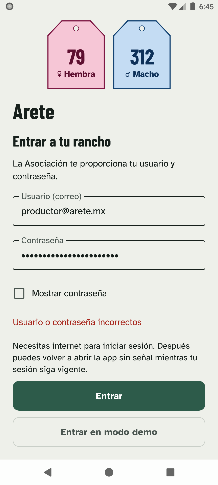
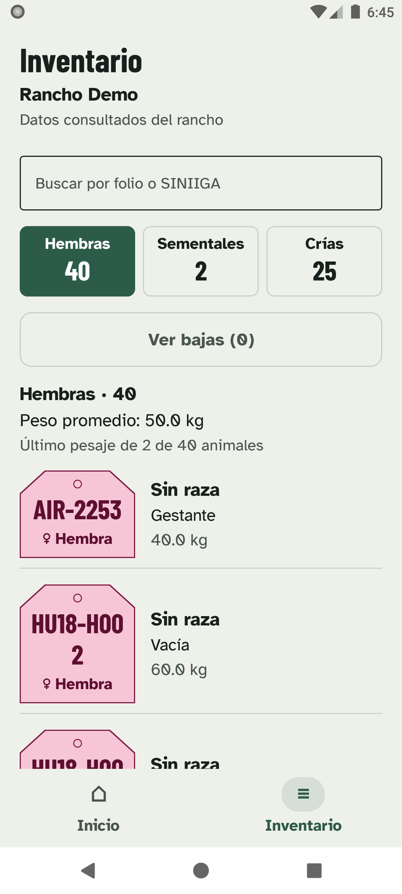
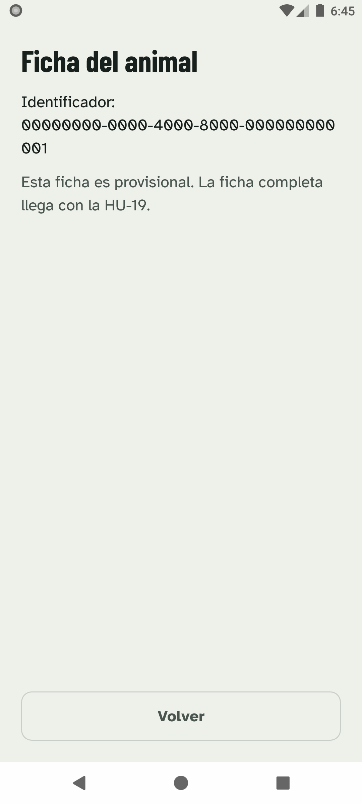
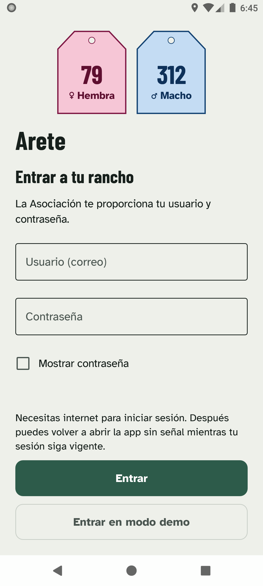

# HU-08 — login, sesión y ranchos autorizados

Revisión del 26 de noviembre de 2026. Este documento sustituye los pendientes
antiguos sobre esperar 30 días o rotar `JWT_SECRET`.

- PR: [#14](https://github.com/eCastilloe/arete-app-ovinos/pull/14), rama `codex/HU-08-integracion`, base `main`.
- Tarjeta: [HU-08](https://trello.com/c/BSSUHYTQ/10-hu-08-pantalla-de-login-app-3).
- Contrato: [OpenAPI de Render](https://arete-api-90hx.onrender.com/openapi.json).
- Acuerdo del equipo: productor y encargado entran a Inventario. La administración de permisos corresponde a HU-12.

## Correcciones de la revisión

1. Se incorporó `main`, que ya incluye el inventario real de HU-18 (#15). Se conservaron la guardia `currentRoute` / `needsRedirect`, la entrada a `AppRoutes.INVENTORY` y el acceso a «Leer arete» desde Inicio.
2. Después de `POST /auth/login`, el cliente consulta `GET /auth/yo` usando el acceso recién recibido. Publica la sesión solo cuando tiene ambos tokens y el perfil válido del mismo usuario.
3. `AuthSession` conserva `usuario_id` y la lista de ranchos: ID, nombre, rol, origen y los cuatro permisos (`puede_capturar`, `puede_editar`, `puede_exportar`, `puede_corregir`). Se usan los DTO tipados del contrato del servidor.
4. DataStore conserva esos datos junto con los tokens y sus caducidades, sin contraseña. Las sesiones anteriores sin perfil pueden restaurarse y consultar `/auth/yo`; un perfil local ilegible no concede permisos y se vuelve a consultar.
5. Al volver al primer plano, `/auth/yo` actualiza los ranchos y permisos. Renovar tokens conserva el perfil y el identificador del inicio de sesión. Una respuesta atrasada no puede restaurar un cierre de sesión ni sobrescribir otro login.
6. El inventario recibe sus ranchos de `AuthRepository.getRanches()` y selecciona el primero autorizado. No usa un ID fijo ni animales de demostración para cuentas reales. La selección entre varios ranchos pertenece a HU-14.
7. Se conserva `TokenStorage.getToken()` por compatibilidad; una demo no produce un Bearer ficticio. La fábrica debug identifica la demo con `getSession()?.isDemo == true`.
8. Los tiempos de conexión, lectura y escritura vuelven a **60 segundos**, como pide la guía. El formulario informa de la espera inicial.
9. `installation.installOptions` incluye `-r` para que Gradle reinstale los APK conservando datos. Se corrigió el error `INSTALL_FAILED_ALREADY_EXISTS` del ejecutor, sin desinstalar la app ni borrar sus datos. [Referencia oficial de Installation](https://developer.android.com/reference/tools/gradle-api/9.1/com/android/build/api/dsl/Installation).

La API sigue siendo la autoridad de permisos y aislamiento. Guardar el perfil no
concede permisos nuevos ni sustituye las comprobaciones del servidor. Si no hay
red, se conserva la sesión todavía vigente; no se inventa un inventario offline.

## Criterios de aceptación

| Criterio | Evidencia |
| --- | --- |
| Credenciales válidas → pantalla acordada | Productor y encargado entran a Inventario con datos consultados de Rancho Demo. |
| Error claro sin borrar el usuario | Contraseña incorrecta → mensaje genérico; correo conservado; se puede corregir y reintentar. |
| Sesión persistente hasta caducar el refresh | Reapertura y recreación de Activity; reapertura real de DataStore; dos renovaciones tras vencimiento natural del acceso; rechazo real del refresh → sesión borrada y Login. La caducidad del refresh se cubre con reloj controlado en pruebas JVM. |
| Botón ≥56 dp, texto ≥16 sp | Aserciones de tamaño en Compose y estilos del formulario entre 16 y 48 sp. |

El criterio 3 se considera cubierto conforme a la revisión de Emmanuel del
21 de noviembre. **No requiere esperar el vencimiento natural de 30 días ni
rotar `JWT_SECRET`**. No se afirma haber observado esos 30 días. La demostración
al Scrum Master, su aprobación y la integración del PR siguen siendo pasos de
la Definition of Done del equipo.

## Pruebas del 26 de noviembre

- Compilación debug, APK de pruebas y Kotlin release: correctos.
- Pruebas JVM: **51 casos, cero fallos y cero errores**.
- Emulador: Android API 26, AVD `Arete_API_26_-_2_GB`, RAM 2048 MB.
- El formulario real se probó con ambas cuentas del equipo: error, entrada, reapertura, lector simulado y cierre de sesión.
- Suite instrumentada completa contra Render y con acceso corto habilitado: **OK (23 tests), 175.307 s**, sin pruebas omitidas. Se instalaron los APK con `adb install -r` y se ejecutó `AndroidJUnitRunner` con `am instrument` y los argumentos optativos indicados abajo.
- `connectedDebugAndroidTest`: **16 pruebas locales aprobadas, 7 optativas omitidas, cero fallos**, tras corregir la reinstalación. El informe registra 23 casos descubiertos y 12.251 s de pruebas. Las 7 optativas sí pasaron en la ejecución completa anterior. Un primer intento con `INSTALL_FAILED_ALREADY_EXISTS` no se contó como aprobado aunque Gradle imprimiera `BUILD SUCCESSFUL`.
- Dos ciclos de vencimiento natural del acceso: 401 confirmado en Render, tokens nuevos persistidos, ranchos y permisos conservados, Inventario visible. Rechazo real del refresh: DataStore vacío y regreso al Login.
- Regresión de Inventario real y demo: ambas cuentas conservaron los conteos 40/2/25, promedio 50.0 kg entre dos hembras pesadas y navegación de Inicio/lector. Estos datos son los de prueba ya existentes en Rancho Demo.

Las pruebas nuevas comprueban permisos actualizados al restaurar, varios ranchos,
usuario sin ranchos, perfil incorrecto o incompleto, error temporal, respuesta
atrasada tras logout u otro login y conservación del perfil al renovar.
Las pruebas reales solo autentican y consultan; no crean ni modifican animales.

## Capturas

| Contraseña incorrecta | Productor en Inventario |
| --- | --- |
|  |  |

| Encargado en Inventario | Lector conservado | Cierre de sesión |
| --- | --- | --- |
|  |  |  |

## Cómo probarlo manualmente

1. Abrir la rama en VS Code y la carpeta `android/` en Android Studio. Usar el emulador API 26 / 2 GB.
2. En `android/local.properties` (ignorado por Git), configurar `API_BASE_URL` con la URL HTTPS de Render y `/` final. Las cuentas se obtienen del equipo; no se agregan al código.
3. Introducir un correo de prueba y contraseña incorrecta. Tocar Entrar: debe mostrar el error y conservar el correo.
4. Corregir la contraseña. Debe abrir Inventario con Rancho Demo y «Datos consultados del rancho».
5. Quitar la app de Recientes y volver a abrirla. Debe mantener la sesión y el Inventario mientras el refresh siga vigente.
6. Ir a Inicio → Leer arete. El lector simulado debe abrir la ficha base. Volver → Cerrar sesión: debe aparecer Login.
7. Repetir con la cuenta del otro rol.
8. Con acceso corto configurado por el equipo, iniciar sesión nueva, enviar la app al fondo, esperar más de un minuto y volver. Debe renovar sin pedir otra vez la contraseña. Repetir una segunda vez.

## Cómo repetir las pruebas automáticas

Desde `android/`, con el JBR de Android Studio como `JAVA_HOME`:

```powershell
.\gradlew.bat :app:assembleDebug :app:testDebugUnitTest :app:assembleDebugAndroidTest :app:compileReleaseKotlin --console=plain
.\gradlew.bat :app:connectedDebugAndroidTest --console=plain
```

En esta máquina, el init script local ignorado `.gradle/hu08-local-build.init.gradle`
dirige los resultados a `%LOCALAPPDATA%/Temp/arete-hu08-build` para evitar bloqueos
de OneDrive. Se pasa con `-I` a Gradle. No es un requisito del repositorio.

Las pruebas contra Render requieren habilitación explícita y argumentos locales
del ejecutor: `liveAuth=true` para `LiveAuthTest` y `LiveLoginScreenTest`;
`liveShortExpiry=true` para `LiveSessionExpiryTest`; `liveInventory=true` para
`LiveInventoryTest`. También necesitan `apiUrl`, `producerEmail`,
`producerPassword`, `workerEmail` y `workerPassword`. No guardar sus valores en
archivos versionados ni capturas.

`LiveSessionExpiryTest` usa tiempo transcurrido real y confirma un 401 del token
vencido con una petición independiente; después reanuda la app y comprueba la
renovación. La app puede renovar anticipadamente: no se confunde ese mecanismo
con la ruta reactiva 401 → refresh → un reintento, cubierta por `LiveAuthTest`.
El rechazo definitivo se provoca alterando únicamente las firmas de la sesión
de prueba local; no modifica secretos de Render ni otras sesiones.

Los resultados válidos deben indicar `OK` sin fallos. Las pruebas optativas
omitidas no cuentan como ejecutadas. Los registros locales de esta revisión están
en `.gradle/hu08-review-build.log`, `.gradle/hu08-review-emulator.log` y
`.gradle/hu08-review-connected-replace.log` (ignorados). El ejecutor de Gradle
emite una advertencia de `sun.misc.Unsafe` procedente de protobuf/JDK; no hubo
advertencias de compilación Kotlin nuevas ni fallos en las pruebas.
