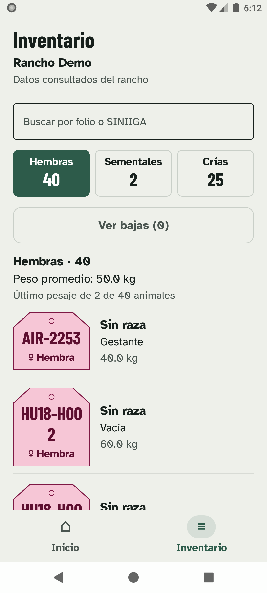
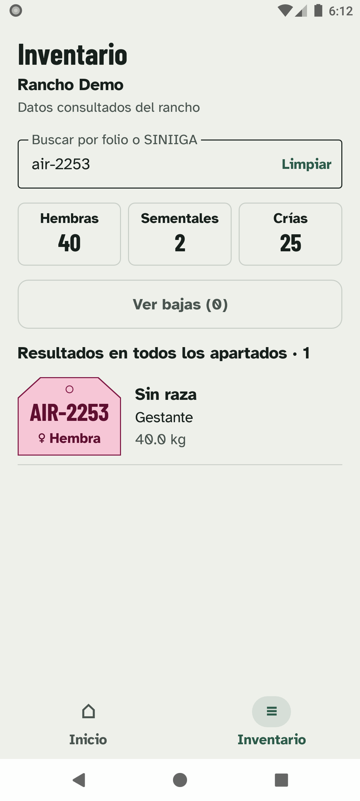
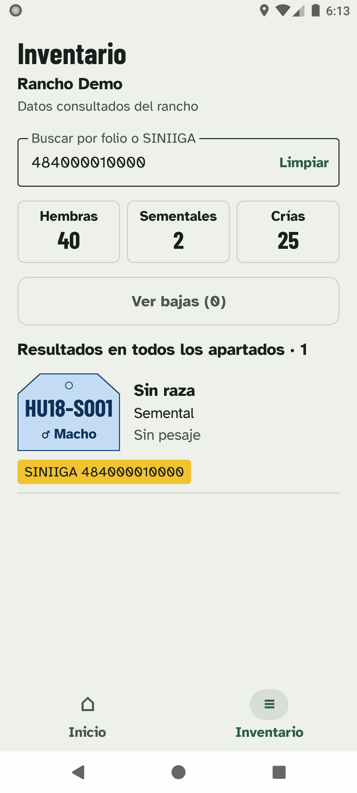
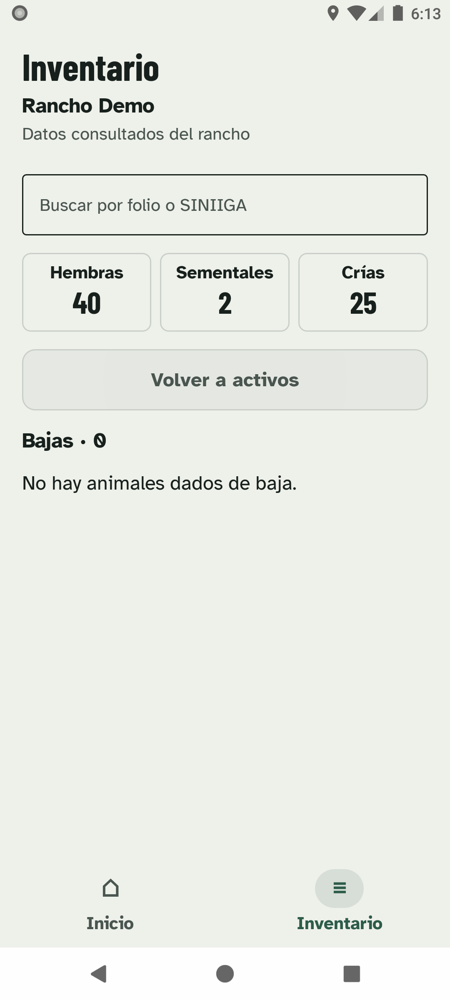
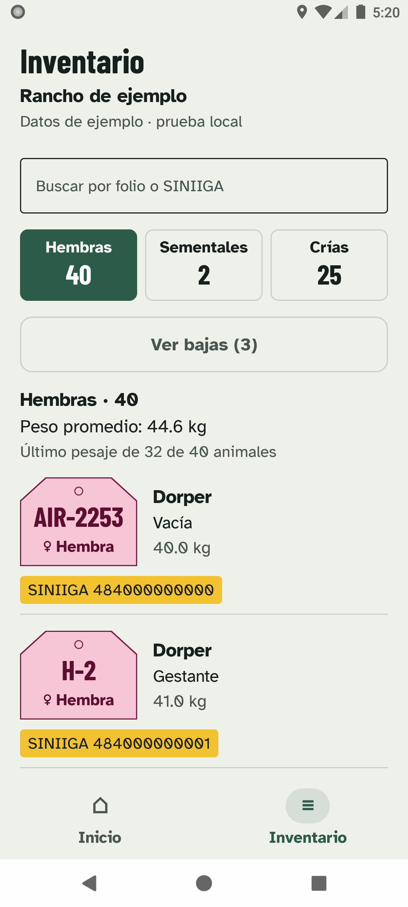

# HU-18: inventario conectado a la API

Revisión del 26 de noviembre de 2026 (America/Mexico_City).
[PR #15](https://github.com/eCastilloe/arete-app-ovinos/pull/15) ·
[Trello](https://trello.com/c/W3EBfmOu/20-hu-18-pantalla-de-inventario-por-apartados-5).
Rama existente `codex/HU-18-inventario`; su renombrado se coordina con Emmanuel.

## Correcciones de la revisión

- Se incorporaron primero los cambios de Emmanuel (`35739d2`, `1e4029b`) y luego
  `origin/main` hasta `f2e9cc3`. Se conservaron `lectorArete`, «Leer arete», la ruta
  `AppRoutes.ANIMAL_DETAIL` y la guardia de navegación de main.
- `RemoteInventoryRepository` consulta `/auth/yo` y toma el primer rancho
  autorizado. No utiliza `DEBUG_RANCH_ID`. El selector multi-rancho es HU-14.
- Si no hay ranchos, aparece «No tienes ranchos asignados», sin controles ni
  animales de inventario. El reintento vuelve a consultar al servidor.
- Se solicita una página de `/ranchos/{id}/animales` con `situacion=todas`,
  `tamano=1000` y `pagina=1`. Búsquedas y filtros se calculan localmente sobre esa
  respuesta. Si está incompleta o corresponde a otro rancho, se muestra error;
  no se publican conteos parciales como si fueran completos.
- Los DTO usan `@SerializedName`. `raza` admite null y se presenta «Sin raza».
  Los cuatro estados se traducen a Vacía, En empadre, Gestante y Lactando.
  La demo ya no utiliza «Mantenimiento».
- Debug decide entre demo y API según la sesión; release usa el repositorio
  remoto y no contiene `DemoInventoryData`.
- La configuración HTTP conserva los 60 segundos del proyecto. El log pasa a
  BASIC para no escribir contraseñas, cuerpos ni tokens en Logcat al probar
  cuentas reales. `LoginRequest` envía `email`, como exige el contrato de Render.

## Límite con HU-08

Esta rama todavía contiene el formulario provisional de login de main. No se
copió el formulario ni la renovación de tokens del PR #14, que se integra después
del #15. `LiveInventoryTest` autentica cada cuenta mediante `AuthRepository`,
abre la actividad real y recorre Inicio → Ver inventario → Inicio. No sustituye
las pruebas del formulario de HU-08.

`TokenStorage.getToken()` se mantiene para compatibilidad. Cuando entre HU-08,
la fábrica demo deberá leer `getSession()?.isDemo`, y ranchos/permisos persistidos
se integrarán con `AuthSession`. El DTO de `/auth/yo` ya incluye esos permisos.

## Evidencia ejecutada

### Datos reales de prueba preparados el 26/11/2026

Con autorización de Marvin se registraron, mediante la API de Render, 67 animales
ficticios en **Rancho Demo** y dos pesajes. La consulta previa confirmó que estaba
vacío. Todos llevan en observaciones `HU-18 prueba autorizada 2026-11-26;
animales ficticios, no ganado real.` Se conservaron los UUID durante la carga
para reanudarla sin duplicados; no se modificó ningún registro ajeno.

| Registros | Folios / valores |
|---|---|
| 40 hembras activas | AIR-2253 y HU18-H002 a HU18-H040 |
| 2 sementales activos | HU18-S001 y HU18-S002 |
| 25 crías lactantes activas | HU18-C001 a HU18-C025 |
| SINIIGA de prueba | 484000010000, de HU18-S001 |
| Dos pesajes de control, 26/11/2026 | AIR-2253: 40 kg; HU18-H002: 60 kg |
| Resultado independiente esperado | Hembras: (40 + 60) / 2 = **50.0 kg**, 2 de 40 pesadas |
| Sin pesajes | Sementales y crías: «Peso promedio: sin pesajes» |

AIR-2253 tiene raza null y estado `gestante`: debe mostrar «Sin raza»,
«Gestante» y «40.0 kg». El resto de hembras también permite comprobar los cuatro
estados del contrato. Los pesos faltantes no entran en el denominador.

Los registros permanecen en el rancho compartido para repetir la demostración.
Las pruebas instrumentadas solo los consultan; no repiten la carga ni crean bajas.

| Comprobación | Resultado |
|---|---|
| Debug, APK de pruebas y Kotlin release | `BUILD SUCCESSFUL` |
| Pruebas JVM | 24, cero fallos; incluye 8 del contrato remoto. Gradle reutilizó el resultado válido porque no cambió código JVM |
| Emulador API 26 / 2048 MB, ejecución final del 26/11 | `OK (12 tests)`, 44.636 segundos |
| Productor y encargado contra Render | 40 hembras / 2 sementales / 25 crías, bajas 0 |
| Promedio real de hembras | 50.0 kg; «Último pesaje de 2 de 40 animales»; sementales y crías sin pesajes |
| Búsqueda real de AIR-2253 desde Crías | Productor 765 ms; encargado 440 ms; ≤1,000 ms, desde reemplazar el texto hasta recomposición y presencia de la fila |
| Búsqueda real por SINIIGA | 484000010000 encuentra HU18-S001; teclado sin foco y captura estable |
| Navegación real | Tres apartados, búsqueda sin resultados, Limpiar, bajas vacías e Inicio correctos |
| Demo / regresión | 40/2/25, bajas, peso promedio, teclado, texto al 150 % y lector simulado |
| Lista de 1,000 animales demo | Búsqueda y recomposición en 214 ms (límite: 1,000 ms) |
| Sin rancho / raza null | Mensaje sin inventario y «Sin raza»/«Gestante» comprobados en pantalla |

Las 12 pruebas son 9 de `InventoryScreenTest` y 3 de `LiveInventoryTest`.
La primera ejecución con los registros reales también pasó (37.399 s; búsquedas
676/447 ms). Se repitió tras estabilizar las capturas del cierre del teclado.
La medición local de 1,000 animales no se presenta como una prueba de 1,000
registros remotos: en Render hay 67.

La suite JVM prueba los códigos del servidor, la página completa, los parámetros
de la petición, el primer rancho autorizado, sesión rechazada, rancho vacío,
respuesta parcial y respuesta de otro rancho. Las pruebas de pantalla verifican
controles de al menos 56 dp; el tema conserva textos de 16 sp o mayores.

### Capturas del emulador

Estas capturas del 26/11 muestran animales ficticios persistidos en el servidor
real, consultados por la app. Las dos primeras corresponden al productor; las
otras dos, al encargado.









Evidencia histórica del 25/11: [Rancho Demo antes de la carga, vacío](evidence/hu18/real-empty.png).
La demo local sigue siendo independiente de estos registros de Render:




## Cómo repetir

1. Usar esta rama, JDK de Android Studio y emulador API 26 / 2 GB.
2. Configurar `API_BASE_URL=https://arete-api-90hx.onrender.com/` en
   `android/local.properties`, ignorado por Git. Mantener la barra final.
3. Desde `android`, ejecutar:

```powershell
.\gradlew.bat :app:assembleDebug :app:testDebugUnitTest :app:assembleDebugAndroidTest :app:compileReleaseKotlin --console=plain
.\gradlew.bat :app:connectedDebugAndroidTest -Pandroid.testInstrumentationRunnerArguments.class=com.arete.app.inventory.InventoryScreenTest
```

4. Para la integración, ejecutar `com.arete.app.inventory.LiveInventoryTest` con
   argumentos locales `liveInventory=true`, `apiUrl`, `producerEmail`,
   `producerPassword`, `workerEmail` y `workerPassword`. Se omite si no se habilita.
   No guardar credenciales en scripts versionados, PRs ni capturas. La suite
   reemplaza la sesión local y termina sin sesión; no crea ni modifica animales.
   Las capturas quedan en los archivos externos de la app, carpeta `hu18-evidence`.
5. Para exigir el conjunto de prueba preparado en Rancho Demo, añadir
   `expectedCounts=40,2,25`, `expectedFemaleAverageKg=50`,
   `expectedWeighedFemales=2`, `expectedFolio=AIR-2253` y
   `expectedSiniiga=484000010000`. La prueba falla si faltan esos registros o si
   los valores no coinciden. Visita cada apartado, compara el promedio, busca
   AIR-2253 desde Crías y mide búsqueda/recomposición en ≤1 s. También busca el
   SINIIGA, comprueba los mensajes sin resultados, limpia, abre Bajas y vuelve a
   Inicio con las dos cuentas. Espera a que termine la actividad de interfaz
   antes de tomar las capturas, incluido el cierre del teclado.
6. Manualmente, Entrar en modo demo → Ver inventario. Buscar `air-2253` y
   `484000010000`; probar `zzzz`; Limpiar; Ver bajas; volver a activos; Inicio;
   Leer arete → ficha provisional → Volver.

En esta máquina un init script ignorado en `.gradle` envía las salidas de build
fuera de OneDrive; no es un requisito del código. Los logs locales de esta
ejecución se guardan en `.gradle/hu18-seeded-build.log`,
`.gradle/hu18-seeded-capture-build.log` y `.gradle/hu18-seeded-emulator-final.log`
y no se publican. El manifiesto local de carga conserva IDs para evitar duplicados;
no contiene credenciales y tampoco se versiona.

## Pendiente para cerrar la historia

- La API disponible no expone una operación de baja. Para la prueba con una baja
  real se necesita un registro preparado por el equipo o la API de HU-21; no se
  modifica la BD directamente ni se implementa esa historia desde HU-18.
- El caso con una baja existente (CA-16.3) sigue aprobado con datos locales,
  pendiente contra Render. La carga real contiene únicamente los 67 activos
  autorizados. El filtro real vacío sí se probó con ambos roles.
- La consulta real con productor/encargado está validada; la matriz de aislamiento
  con otro rancho y una cuenta sin acceso requiere los datos/cuentas del equipo.
- Demostrar al Scrum Master, obtener revisión/aprobación y check `pytest (api)`
  en verde antes de fusionar. La tarjeta no está terminada.
- Offline/sincronización, selector de rancho, ficha completa y demás módulos
  conservan su alcance en sus propias historias.
