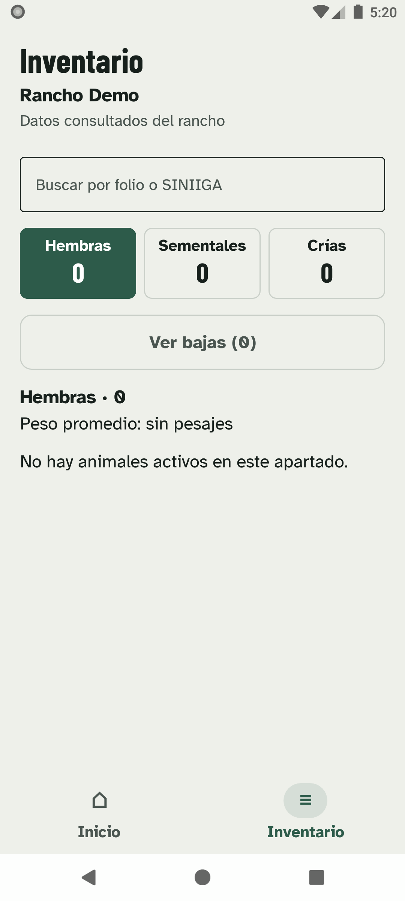
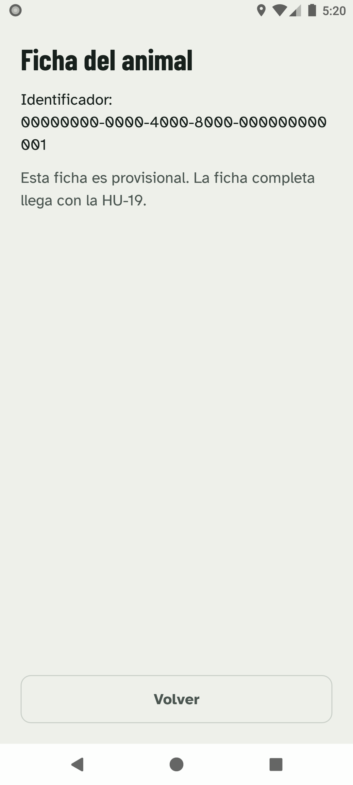

# HU-18: inventario conectado a la API

Revisión del 25 de noviembre de 2026 (America/Mexico_City).
[PR #15](https://github.com/eCastilloe/arete-app-ovinos/pull/15) ·
[Trello](https://trello.com/c/W3EBfmOu/20-hu-18-pantalla-de-inventario-por-apartados-5).
Rama existente `codex/HU-18-inventario`; su renombrado se coordina con Emmanuel.

## Correcciones de la revisión

- Se incorporaron primero los cambios de Emmanuel (`35739d2`, `1e4029b`) y luego
  `origin/main` hasta `f2e9cc3`. Se conservaron `lectorArete`, «Leer arete», la ruta
  `AppRoutes.ANIMAL_DETAIL` y la guardia de navegación de main.
- `RemoteInventoryRepository` consulta `/auth/yo` y toma el primer rancho
  autorizado. No utiliza `DEBUG_RANCH_ID`. El selector multi-rancho es HU-14.
- Si no hay ranchos, aparece «No tienes ranchos asignados», sin controles ni
  animales de inventario. El reintento vuelve a consultar al servidor.
- Se solicita una página de `/ranchos/{id}/animales` con `situacion=todas`,
  `tamano=1000` y `pagina=1`. Búsquedas y filtros se calculan localmente sobre esa
  respuesta. Si está incompleta o corresponde a otro rancho, se muestra error;
  no se publican conteos parciales como si fueran completos.
- Los DTO usan `@SerializedName`. `raza` admite null y se presenta «Sin raza».
  Los cuatro estados se traducen a Vacía, En empadre, Gestante y Lactando.
  La demo ya no utiliza «Mantenimiento».
- Debug decide entre demo y API según la sesión; release usa el repositorio
  remoto y no contiene `DemoInventoryData`.
- La configuración HTTP conserva los 60 segundos del proyecto. El log pasa a
  BASIC para no escribir contraseñas, cuerpos ni tokens en Logcat al probar
  cuentas reales. `LoginRequest` envía `email`, como exige el contrato de Render.

## Límite con HU-08

Esta rama todavía contiene el formulario provisional de login de main. No se
copió el formulario ni la renovación de tokens del PR #14, que se integra después
del #15. `LiveInventoryTest` autentica cada cuenta mediante `AuthRepository`,
abre la actividad real y recorre Inicio → Ver inventario → Inicio. No sustituye
las pruebas del formulario de HU-08.

`TokenStorage.getToken()` se mantiene para compatibilidad. Cuando entre HU-08,
la fábrica demo deberá leer `getSession()?.isDemo`, y ranchos/permisos persistidos
se integrarán con `AuthSession`. El DTO de `/auth/yo` ya incluye esos permisos.

## Evidencia ejecutada

| Comprobación | Resultado |
|---|---|
| Debug, APK de pruebas y Kotlin release | `BUILD SUCCESSFUL` |
| Pruebas JVM | 24, cero fallos; incluye 8 nuevas del contrato remoto |
| Emulador API 26 / 2048 MB | `OK (12 tests)`, 32.667 segundos |
| Productor y encargado contra Render | Consulta correcta de Rancho Demo, vacío: 0/0/0, bajas 0 |
| Navegación real | Búsqueda sin resultados, Limpiar, bajas vacías e Inicio correctos |
| Demo / regresión | 40/2/25, bajas, peso promedio, teclado, texto al 150 % y lector simulado |
| Lista de 1,000 animales demo | Búsqueda y recomposición en 252 ms (límite: 1,000 ms) |
| Sin rancho / raza null | Mensaje sin inventario y «Sin raza»/«Gestante» comprobados en pantalla |

La suite JVM prueba los códigos del servidor, la página completa, los parámetros
de la petición, el primer rancho autorizado, sesión rechazada, rancho vacío,
respuesta parcial y respuesta de otro rancho. Las pruebas de pantalla verifican
controles de al menos 56 dp; el tema conserva textos de 16 sp o mayores.

### Capturas del emulador

La primera captura es del servidor real; la segunda usa exclusivamente la demo.
Los 40/2/25 de la demo no se atribuyen a Render.






## Cómo repetir

1. Usar esta rama, JDK de Android Studio y emulador API 26 / 2 GB.
2. Configurar `API_BASE_URL=https://arete-api-90hx.onrender.com/` en
   `android/local.properties`, ignorado por Git. Mantener la barra final.
3. Desde `android`, ejecutar:

```powershell
.\gradlew.bat :app:assembleDebug :app:testDebugUnitTest :app:assembleDebugAndroidTest :app:compileReleaseKotlin --console=plain
.\gradlew.bat :app:connectedDebugAndroidTest -Pandroid.testInstrumentationRunnerArguments.class=com.arete.app.inventory.InventoryScreenTest
```

4. Para la integración, ejecutar `com.arete.app.inventory.LiveInventoryTest` con
   argumentos locales `liveInventory=true`, `apiUrl`, `producerEmail`,
   `producerPassword`, `workerEmail` y `workerPassword`. Se omite si no se habilita.
   No guardar credenciales en scripts versionados, PRs ni capturas. La suite
   reemplaza la sesión local y termina sin sesión; no crea ni modifica animales.
   Las capturas quedan en los archivos externos de la app, carpeta `hu18-evidence`.
5. Con un conjunto real 40/2/25 preparado, añadir `expectedCounts=40,2,25` para
   exigir esos conteos. Las filas reales y su peso se contrastan con la API.
6. Manualmente, Entrar en modo demo → Ver inventario. Buscar `air-2253` y
   `484000010000`; probar `zzzz`; Limpiar; Ver bajas; volver a activos; Inicio;
   Leer arete → ficha provisional → Volver.

En esta máquina un init script ignorado en `.gradle` envía las salidas de build
fuera de OneDrive; no es un requisito del código. Los logs locales de esta
ejecución se guardan en `.gradle/hu18-live-build.log` y
`.gradle/hu18-emulator-review.log` y no se publican.

## Pendiente para cerrar la historia

- Preparar datos reales de prueba: el Rancho Demo compartido está vacío. Falta
  repetir en Render los conteos 40/2/25, encontrar AIR-2253, ver una baja existente
  y comprobar un promedio con pesajes. Se solicitó a Marvin confirmar la creación
  de 67 animales ficticios y dos pesajes; aún no se han creado.
- La API disponible no expone una operación de baja. Para la prueba con una baja
  real se necesita un registro preparado por el equipo o la API de HU-21; no se
  modifica la BD directamente ni se implementa esa historia desde HU-18.
- Demostrar al Scrum Master, obtener revisión/aprobación y check `pytest (api)`
  en verde antes de fusionar. La tarjeta no está terminada.
- Offline/sincronización, selector de rancho, ficha completa y demás módulos
  conservan su alcance en sus propias historias.
