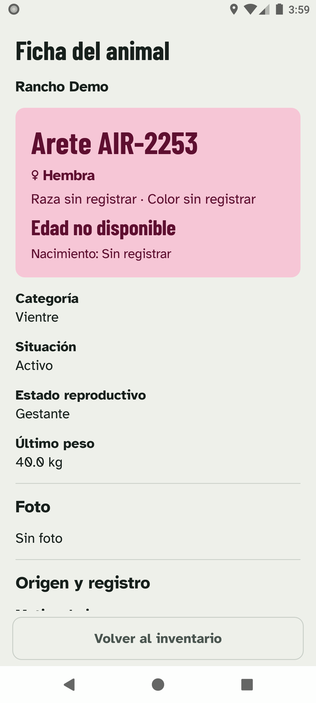
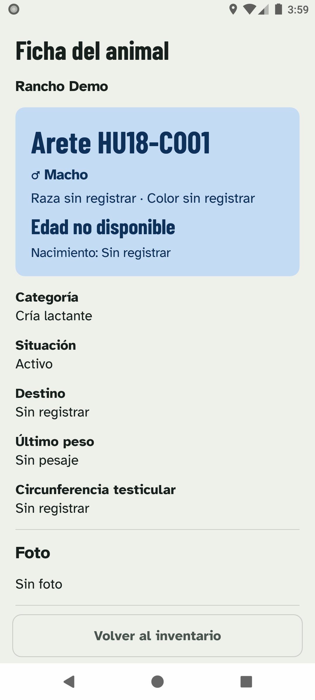
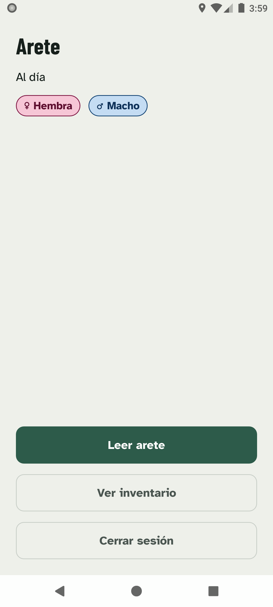

# HU-20 — Ficha real, edad y color por sexo

Actualizado el 26/11/2026. [PR #17](https://github.com/eCastilloe/arete-app-ovinos/pull/17) · [Trello](https://trello.com/c/MzKiTxtm).

## Estado y contexto

Correcciones del comentario de FelipeRmz29 del 23/11. Revisados AGENTS.md entregado por Marvin, contexto del proyecto, backlog HU-20, SRS RF-05/RF-15 y guía visual. HU-19 sigue en revisión: se incorporó su commit `9259518` a `codex/HU-20-detalle`, conservando los cambios de Emmanuel en `3c91c84`. El PR conserva base `codex/HU-19-ficha` y estado Draft. No se fusionó nada a main.

## Qué cambió, explicado paso a paso

1. **Actualizar la rama:** `pull` descarga los cambios que publicó el equipo; la integración conserva la ficha de HU-20 y las correcciones reales de login, inventario y edición. Se resolvieron los cruces en AppContainer y AreteNavHost.
2. **Consultar la ficha:** `RemoteAnimalDetailRepository.kt` pide `GET /animales/{id}`. Primero actualiza la sesión y consulta el rancho autorizado. Rechaza respuestas de otro rancho, otro ID o progenitores externos usados como ficha. Un encargado sin permiso de edición puede leer. Los errores no se sustituyen por datos demo.
3. **Elegir el origen:** las fábricas de debug permiten la sesión demo explícita. En release se usa siempre el repositorio remoto. Se conserva el interceptor de renovación de HU-08.
4. **Dibujar la pantalla:** Kotlin es el lenguaje; Jetpack Compose crea los textos, colores y botones. El ViewModel carga el repositorio y entrega su estado a la pantalla. Se conservan rosa/hembra, azul/macho, errores/reintento y valores ausentes explícitos.
5. **Peso y medida:** se muestra el último pesaje; si falta, el peso al nacer con la indicación `(al nacer)`; si ambos faltan, `Sin pesaje`. La circunferencia aparece solo en machos, con fecha de su última medición disponible cuando existe.
6. **Navegar:** Inventario y Leer arete usan `AppRoutes.ANIMAL_DETAIL`. Editar regresa a la ficha y solicita recarga. Inicio funciona también cuando el login abrió directamente Inventario. El regreso desde una lectura indica `Volver a Inicio`.
7. **Probar y documentar:** pruebas automáticas de lógica, interfaz y consultas reales con ambas cuentas; capturas guardadas junto a esta guía.

Los progenitores son texto, sin enlaces: navegar a madre/padre corresponde a HU-23. No se agregaron acciones de parto, pesaje, baja ni árbol genealógico.

## Contrato de API y cambio de backend pendiente de despliegue

Se consultó el OpenAPI publicado en `https://arete-api-90hx.onrender.com/openapi.json`. El despliegue actual entrega `ultimo_peso_kg`, pero no peso al nacer ni circunferencia. Por eso este PR incluye una ampliación de lectura en Python/SQL (`api/app/routers/animales.py` y `api/app/schemas/animal.py`):

| Campo opcional nuevo | Origen |
| --- | --- |
| `peso_nacimiento_kg` | `parto_cria` de la misma cría, rancho y parto de origen; excluye cría/parto anulados |
| `ultima_circunferencia_testicular_cm` | Último pesaje no anulado que tenga medida, solo macho y mismo rancho |
| `fecha_ultima_circunferencia` | Fecha de esa misma medición |

El orden de pesajes usa fecha, creación e ID. `ultimo_peso_kg` sigue significando pesaje; la app elige el peso al nacer únicamente como alternativa. No se cambian escrituras, tablas ni permisos. No hay migración nueva. Los nuevos campos son opcionales para mantener compatibilidad con la API actualmente desplegada.

**Felipe debe revisar y desplegar esta ampliación.** El peso al nacer y la circunferencia ya están probados con datos temporales y contratos controlados, pero todavía no pueden declararse comprobados contra Render. Después del despliegue hay que repetir con una cría que tenga peso de parto y ningún pesaje, y un macho con medida.

Las fotografías existentes se leen del almacenamiento privado de este celular, asociadas por rancho/animal. Se indica esa procedencia. Este PR no implementa descarga ni sincronización de fotos: el contrato de ficha desplegado no expone un identificador de fotografía.

## Resultados del 26/11/2026

| Comprobación | Resultado |
| --- | --- |
| Android JVM `testDebugUnitTest` | 118 aprobadas, 0 fallos |
| Pantallas y regresión en API 26 / RAM 2048 MB | 36 aprobadas; 9 pruebas optativas omitidas por no activar sus escenarios de otras HU |
| `LiveAnimalDetailTest` con Render | 2 aprobadas: productor y encargado; solo lectura de datos existentes |
| `assembleDebug`, APK de pruebas y `compileReleaseKotlin` | Correctos |
| `lintDebug` | 0 errores, 29 advertencias existentes en el proyecto |
| Backend `pytest -q` | 99 aprobadas, 87 omitidas porque requieren BD/configuración externa |
| Backend propias HU-20 | 8 aprobadas; consulta SQL real ejecutada sobre SQLite temporal |
| `git diff --check` | Sin errores |

Las pruebas SQLite comprueban selección, orden, datos ausentes y exclusión de registros anulados/ajenos; **no sustituyen las pruebas RLS sobre PostgreSQL**. La suite de aislamiento del equipo sigue pendiente de ejecutarse con su BD de pruebas. En esta ejecución no se crearon, editaron ni borraron animales reales.

El workflow `Pruebas backend / pytest (api)` se activa para PR con base main. Al conservar temporalmente base HU-19 no se atribuye un éxito de CI a este PR; pytest se ejecutó localmente. Al integrar #16 se deberá cambiar base a main, actualizar la rama y verificar ese check.

### Edad y accesibilidad

- `01/08/2026 → 12/11/2026`: **3 meses 11 días**.
- `31/01/2026 → 28/02/2026`: **0 meses 28 días**.
- `31/01/2026 → 01/03/2026`: **1 mes 1 día**.
- `29/02/2024 → 28/02/2025`: **11 meses 30 días**; `29/02/2024 → 01/03/2025`: **12 meses 1 día**.
- `29/02/2024 → 29/02/2028`: **48 meses 0 días**.

Se mantiene la convención `java.time.Period.between`: meses completos y días de calendario, sin dividir por 30 ni redondear el 31 de enero a un mes el 28 de febrero. La consulta utiliza la fecha de America/Mexico_City; datos inválidos/ausentes/futuros no producen edades inventadas.

`AnimalDetailScreenTest.birthWeightFallbackIsExplicitAndAllRenderedTextIsAtLeast16sp` obtiene los `TextLayoutResult` de los textos dibujados y exige tamaño ≥16 sp; mide los botones Editar, Inicio y Volver ≥56 dp. La prueba de error mide también Reintentar. Las pruebas incluyen texto al 150 %, permiso de solo lectura, bajas, ausencia de edad/peso y rechazo de datos anteriores tras fallar una recarga.

### Evidencia de Render

AIR-2253 tiene 40.0 kg y estado Gestante. HU18-C001 es macho sin pesaje. En estos registros semilla faltan raza/color/nacimiento; se comprueba que la pantalla lo indique sin inventarlos. Se verificó edición accesible para productor, ausencia del botón para encargado, regreso al inventario y a Inicio.






## Cómo repetirlo

1. Abrir la carpeta de HU-20 en VS Code y `android/` en Android Studio para usar el emulador API 26 / 2 GB. La URL va en `android/local.properties` ignorado por Git: `API_BASE_URL=https://arete-api-90hx.onrender.com/`.
2. Ejecutar la app debug. Entrar con la cuenta de productor compartida por el equipo; Inventario → Ver ficha en AIR-2253. Comprobar color, sexo, estado y 40.0 kg, sin circunferencia. Abrir Editar y volver a la ficha sin guardar.
3. Volver al inventario y buscar HU18-C001. Ver ficha: azul, Macho, Sin pesaje y Circunferencia/Sin registrar. Ir a Inicio.
4. Cerrar sesión y repetir con encargado. Puede consultar ambas fichas; no aparece Editar. No cambiar sus permisos para la prueba.
5. Para datos completos de edad/progenitores, consultar el animal ficticio de HU-19 que ya existe en Rancho Demo. Los progenitores se muestran como texto.
6. Para edad fija, peso al nacer y accesibilidad, ejecutar las pruebas controladas. No cambiar el reloj del emulador.

Comandos desde `android/` (JDK de Android Studio):

```powershell
.\gradlew.bat :app:testDebugUnitTest :app:assembleDebug :app:assembleDebugAndroidTest :app:compileReleaseKotlin :app:lintDebug
.\gradlew.bat :app:connectedDebugAndroidTest -Pandroid.testInstrumentationRunnerArguments.class=com.arete.app.animal.AnimalDetailScreenTest
```

Las pruebas reales son optativas: `LiveAnimalDetailTest` requiere argumentos `liveAnimalDetail=true`, `apiUrl`, `ranchId`, `producerEmail`, `producerPassword`, `workerEmail`, `workerPassword`. Pasarlos solo al ejecutar; no guardarlos en Git, capturas ni comentarios. No activar las otras pruebas reales de alta/borrado de datos para repetir esta consulta.

En este equipo, un init script local ignorado redirige las carpetas generadas a Temp para evitar los bloqueos de OneDrive. No es una dependencia del proyecto. Para pytest en Windows se usó `PGCONNECT_TIMEOUT=3` para limitar la espera de `/salud` contra la BD local ausente.

## Pendientes para cerrar la historia

- [ ] Integrar HU-19 #16; cambiar la base de #17 a main y actualizar sin perder los cambios del equipo.
- [ ] Revisar/desplegar los tres campos de lectura y repetir peso al nacer/circunferencia contra Render.
- [ ] Ejecutar pruebas de BD/RLS con la infraestructura de pruebas del equipo y comprobar el check obligatorio de CI.
- [ ] Validación de Max en HU-61, demostración a Felipe/Scrum Master y aprobación del PR.

Los cuatro criterios de presentación conservan su comprobación. La tarjeta sigue en Code Review y el PR en Draft; no se marca Hecho mientras estos pendientes sigan abiertos.
